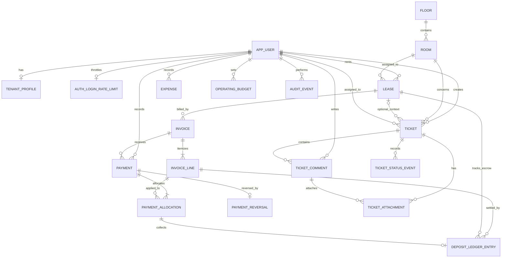

# Draft ERD dan Kontrak Operasi M05 — RumaKost

> Status: Rancangan ERD dan kontrak operasi logis ini ditinjau dalam technical sign-off M05 pada 2026-10-31; diperbarui untuk CR-2026-001/002 dan penutupan gap persistensi WF-03 pada 2026-11-01. Dokumen ini bukan migrasi database atau implementasi API; constraint fisik dan verifikasi runtime dikerjakan pada M06. Scope mengikuti `docs/pm/SCOPE_STATEMENT.md` dan `M05-TECHNICAL-SPEC-DRAFT.md`.

## 1. Batas rancangan

- Satu properti demo, tiga role aplikasi (`OWNER`, `STAFF`, `TENANT`), tidak ada public sign-up.
- Database menyimpan data operasional dan jejak audit; auth provider menyimpan kredensial dan sesi.
- Pembayaran tidak memindahkan uang. Tidak ada integrasi bank/payment gateway.
- Deposit escrow termasuk dalam slice P0 berdasarkan WF-03/WF-04/WF-05/WF-06/WF-10 dan E2E Alur 1 & 5. Model mendukung nilai default kamar, nilai kontrak, komponen invoice awal, saldo escrow, settlement ke tagihan, dan rekonsiliasi check-out. Prorata dan mode satu bulan penuh berbasis tanggal masuk sama-sama didukung sesuai WF-04/WF-05. Keputusan sebelumnya untuk tanpa prorata/due day per kontrak digantikan oleh arahan pemilik agar M05 mengikuti M04. Denda umum, diskon tahunan, meteran utilitas, izin tamu, renewal mandiri, akun teknisi, OTP/2FA, rating, dan ekspor lanjutan tetap di luar P0 kecuali scope diubah.
- Semua nilai uang disimpan sebagai `NUMERIC(12,2)` atau representasi Decimal setara; API mengirim nominal sebagai string desimal agar presisi tidak hilang.
- Tanggal kalender disimpan sebagai `DATE`; timestamp audit disimpan UTC. Zona tampilan: `Asia/Jakarta`.
- **Arahan pemilik terbaru 2026-10-30:** wireframe/runbook M04 menjadi sumber aturan billing: mode prorata sampai akhir bulan atau satu bulan kalender penuh pada siklus tanggal masuk. Keputusan no-prorata dan due day per kontrak yang disampaikan sebelumnya digantikan.
- **Arahan pemilik 2026-10-30:** deposit escrow dicakup seperti alur check-in, invoice pertama, settlement, dan check-out yang ada di M04.
- **Penyelarasan role terhadap M04:** Owner/Staff berizin dapat membuat kontrak dan mencatat pengeluaran; Penghuni dapat mengajukan check-out; Owner melakukan inspeksi dan menyetujui rekonsiliasi finansial deposit. Staff dapat mencatat payment `PENDING`, tetapi tidak mengubah kontrak aktif, mengesahkan pembayaran, atau melihat laporan finansial.
- **CR-2026-001, disetujui Owner 2026-11-01:** dimensi kamar opsional (panjang/lebar dalam meter) dan satu pagu pengeluaran operasional per bulan kalender masuk P0 F-02/F-06. Skala tetap Medium dan satu properti.
- **CR-2026-002, disetujui Owner 2026-11-01:** F-02 menggunakan katalog lantai satu properti, pengarsipan kamar/lantai untuk mempertahankan histori, kode kamar kanonik, rentang tarif/deposit terbatas, dan tidak menyertakan foto kamar. Skala dan tujuh kelompok P0 tetap.

## 2. Model data logis

### Entitas dan constraint utama

| Entitas | Kolom inti (usulan) | Constraint/invarian |
|---|---|---|
| `Floor` | `id UUID`, `name`, `normalizedName UNIQUE`, `archivedAt?`, timestamps | Katalog lantai untuk satu properti; lantai boleh kosong. Nama setelah trim/case normalization unik. Pengarsipan hanya jika tidak ada kamar yang belum diarsipkan. Database menolak hard delete. |
| `AppUser` | `id UUID`, `authSubject UNIQUE`, `emailNormalized UNIQUE`, `displayName`, `role`, `isActive`, `mustChangePassword`, `createdBy?`, timestamps | `authSubject` menunjuk ID user Better Auth dan tetap stabil saat email login berubah; `emailNormalized` mencerminkan email canonical yang sudah diverifikasi serta unik. Canonical berarti lowercase dan tanpa spasi ASCII di tepi; DB menolak nilai kosong/non-canonical. Role aplikasi hanya tiga role MVP dan menjadi sumber otorisasi; tidak menyimpan password/token sesi. Hanya Owner memulai perubahan email login. |
| `AuthLoginRateLimit` | `appUserId PK/FK`, `attemptTimestamps TIMESTAMPTZ[]`, `consecutiveFailures`, `blockedUntil?`, `updatedAt` | Satu baris per akun aplikasi; hanya menyimpan maksimal lima waktu percobaan terbaru dalam jendela geser 60 detik, bukan email/IP/password/token. Fungsi DB mereservasi percobaan secara atomik, merekam kegagalan dengan progressive delay yang dibatasi parameter backend (1–60 detik awal, maksimum 15 menit), dan mereset rangkaian kegagalan setelah login sukses. IP dibatasi terpisah oleh edge/WAF. |
| `TenantProfile` | `userId PK/FK`, `phoneE164?`, `occupation?`, `employer?`, `cityOfOrigin?`, `emergencyContactName?`, `emergencyContactRelation?`, `emergencyContactPhoneE164?`, `emergencyContactNote?` | Data pekerjaan/kota asal opsional; telepon penghuni dan kontak darurat tervalidasi E.164, non-unique karena nomor keluarga dapat dipakai bersama. Nama dan nomor kontak darurat harus terisi berpasangan. Catatan kontak darurat lama dipertahankan. Tidak menyimpan NIK/dokumen identitas atau nomor kendaraan. |
| `Room` | `id UUID`, `code UNIQUE`, `floorId? FK`, `roomType?`, `widthMeters?`, `lengthMeters?`, `monthlyRent NUMERIC`, `depositDefaultAmount NUMERIC`, `physicalStatus`, `maintenanceNote?`, `archivedAt?`, timestamps | Kode disimpan trim-uppercase, 1–10 karakter A–Z/0–9/tanda hubung, dan unik; tipe kamar opsional tanpa katalog dinamis; dimensi meter harus diisi berpasangan dan positif; luas diturunkan dan tidak disimpan; tarif Rp1–100.000.000 dan deposit Rp0–100.000.000; operasi membuat kamar menghitung default deposit 50% tarif, dibulatkan ke kelipatan Rp50.000 seperti WF-03, lalu dapat diedit Owner. Catatan operasional saat ini dibatasi 500 karakter; riwayat insiden disimpan melalui Ticket. Perubahan status fisik/pengarsipan diblok selama ada Lease `SCHEDULED` atau `ACTIVE`; kamar tidak boleh aktif pada lantai arsip. Database menolak hard delete. Foto kamar tidak termasuk P0. |
| `Lease` | `id UUID`, `contractNumber? UNIQUE`, `tenantUserId FK`, `roomId FK`, `startsOn DATE`, `endsOn DATE?`, `rentAmount NUMERIC`, `depositAgreedAmount NUMERIC`, `billingMode ENUM`, `status`, `createdBy FK`, timestamps | Nomor SPK opsional dan unik bila disimpan; `endsOn > startsOn` dan inklusif; satu kamar maupun Tenant tidak boleh punya rentang Lease bertumpang tindih yang statusnya bukan `CANCELLED`, termasuk histori `ENDED`; backend mengunci Tenant dan Room saat membuat/mengakhiri Lease, sementara DB exclusion melindungi periode `SCHEDULED`/`ACTIVE`; `billingMode` adalah `PRORATA_TO_MONTH_END` atau `FULL_MONTH_ANNIVERSARY`; nominal deposit kontrak dapat nol; perubahan tidak menghapus histori. |
| `LeaseEndRequest` | `id UUID`, `(leaseId, requestedByTenantId) FK -> Lease(id, tenantUserId)`, `requestedEndOn DATE`, `reason?`, `status`, `reviewedByOwnerId? FK`, `reviewedAt?`, timestamps | Composite FK DB memastikan pemohon adalah Tenant pemilik Lease; Owner meninjau/menentukan tanggal akhir dan menjalankan inspeksi serta rekonsiliasi deposit. Role/pemanggil tetap diverifikasi server. |
| `Invoice` | `id UUID`, `leaseId FK`, `periodStart DATE`, `periodEnd DATE`, `dueOn DATE`, `kind`, `amountDue NUMERIC`, `issuedAt`, `deliveryStatus`, `voidedAt?`, timestamps | Invoice harus berisi setidaknya satu line pada akhir transaksi pembuatan; unique lease/periode/jenis mencegah duplikasi; total sama dengan jumlah line; status dibayar/parsial/terlambat diturunkan dari alokasi pembayaran terverifikasi/reversal. Invoice hanya dapat di-void setelah payment pending ditolak dan seluruh payment verified direversal. |
| `InvoiceLine` | `id UUID`, `invoiceId FK`, `kind ENUM(RENT, DEPOSIT)`, `description`, `amount NUMERIC`, `periodStart?`, `periodEnd?` | Nilai positif; hanya dapat ditambah ke invoice `ISSUED` dan tidak dapat diubah/dihapus setelah tercatat. Invoice awal dapat punya line sewa dan deposit terpisah; deposit bukan pendapatan sewa. Jenis biaya lain belum masuk P0. |
| `Payment` | `id UUID`, `invoiceId FK`, `amount NUMERIC`, `method ENUM(TRANSFER, QRIS, CASH)`, `status`, `recordedBy FK`, `verifiedBy? FK`, `verifiedAt?`, `rejectedBy? FK`, `rejectedAt?`, `rejectionReason?`, `reference? UNIQUE`, timestamps | `amount > 0`; metode terbatas pada pencatatan manual transfer bank, QRIS, atau tunai; detail rekening tujuan tidak dimodelkan. Referensi opsional, unik, dan tidak boleh kosong jika diisi. Payment harus mulai `PENDING`; hanya transisi `PENDING` ke `VERIFIED`/`REJECTED` yang valid. Penolakan wajib menyimpan alasan nonblank yang immutable. Payment tidak dapat dihapus; koreksi payment verified memakai reversal. Hanya `VERIFIED` tanpa reversal berdampak ke saldo. Hanya Owner memverifikasi/menolak; Staff tidak dapat memverifikasi catatannya sendiri. |
| `PaymentAllocation` | `id UUID`, `paymentId FK`, `invoiceLineId FK`, `amount NUMERIC` | Alokasi positif dan append-only; payment dan line harus berasal dari invoice yang sama dan invoice `ISSUED`; total alokasi tidak boleh melebihi nilai payment. Saat verifikasi, seluruh nilai payment harus teralokasi dan total alokasi aktif tidak boleh melampaui invoice maupun line; tidak ada credit balance/surplus; deposit dianggap terkumpul hanya dari alokasi terverifikasi ke line deposit. |
| `DepositLedgerEntry` | `id UUID`, `leaseId FK`, `invoiceLineId? FK`, `kind ENUM(COLLECTED, COLLECTION_REVERSED, APPLIED_TO_RENT, WITHHELD_AT_CHECKOUT, REFUNDED)`, `amount NUMERIC`, `paymentAllocationId? UNIQUE FK`, `reversedPaymentAllocationId? UNIQUE FK`, `reason?`, `refundStatus?`, `createdBy FK`, timestamps | Append-only kecuali transisi refund `PENDING` ke `PAID`/`REJECTED`; amount positif; saldo turunan = terkumpul − koleksi direversal − settlement − withholding − refund aktif dan tidak boleh negatif. DB mengunci Lease saat insert; `COLLECTED` harus sama dengan alokasi ke line `DEPOSIT` pada invoice Lease yang sama dan payment `VERIFIED` tanpa reversal. Reversal payment otomatis menambah `COLLECTION_REVERSED` untuk setiap alokasi deposit yang telah tercatat; event wajib merujuk alokasi asal dan beralasan. Reversal ditolak jika saldo bebas tidak cukup, termasuk refund pending yang masih dipesan. `APPLIED_TO_RENT` harus menunjuk line sewa pada Lease yang sama dan invoice berstatus `ISSUED`. Refund/pemotongan butuh alasan; refund baru dimulai `PENDING`, dan refund `REJECTED` melepas reservasi. |
| `PaymentReversal` | `id UUID`, `paymentId UNIQUE FK`, `amount NUMERIC`, `reason`, `createdBy OWNER FK`, `createdAt` | Maksimal satu reversal penuh per payment `VERIFIED`; nilai harus sama dengan payment asal, alasan wajib, dan baris append-only. Tidak mengubah/menghapus payment asal. Jika payment punya alokasi deposit yang sudah tercatat, reversal dan event kompensasi escrow dibuat atomik; reversal ditolak jika dana bebas escrow tidak cukup. |
| `IdempotencyKey` | `key UUID PK`, `operation`, `responseCode?`, `responsePayload? JSONB`, `completedAt?`, `createdAt` | Key unik per operasi dan hasil disimpan bersama mutasi bisnis dalam satu transaksi; retry mengembalikan hasil tersimpan. Retensi/pembersihan key merupakan kebijakan operasional, bukan penghapusan transaksi finansial. |
| `Expense` | `id UUID`, `category`, `amount NUMERIC`, `occurredOn DATE`, `description`, `recordedBy FK`, `createdAt` | Kategori dan deskripsi nonblank; nominal positif; menjadi arus kas keluar F-06. Append-only dan tidak dapat dihapus/ditimpa. Owner/Staff berizin dapat mencatat; hanya Owner dapat melihat laporan. Koreksi memakai reversal penuh oleh Owner, lalu catatan Expense baru bila diperlukan. |
| `ExpenseReversal` | `id UUID`, `expenseId UNIQUE FK`, `amount NUMERIC`, `reason`, `createdBy OWNER FK`, `createdAt` | Maksimal satu reversal penuh per Expense; nilai sama dengan Expense asal; alasan wajib/nonblank; append-only, tidak dapat diubah/dihapus. DB memverifikasi role Owner, nilai penuh, dan keunikan. AuditEvent dan IdempotencyKey ditulis bersama oleh backend dalam satu transaksi. Reversal adalah penyesuaian kas positif, bukan pendapatan sewa atau bukti uang masuk dari bank. |
| `OperatingBudget` | `id UUID`, `periodStart DATE`, `amount NUMERIC`, `updatedBy FK`, timestamps | Satu nilai positif per bulan kalender (tanggal periode selalu hari pertama); Owner dapat membuat/memperbarui; perubahan dicatat dalam `AuditEvent`; tidak ada default; laporan Owner membandingkan expense tercatat dalam bulan yang sama dengan pagu. |
| `Ticket` | `id UUID`, `ticketNumber BIGINT UNIQUE`, `roomId FK`, `leaseId? FK`, `createdBy FK`, `statusChangedBy? FK`, `cancelledBy? FK`, `category ENUM(AC, PLUMBING, ELECTRICAL, DOORS_LOCKS, FURNITURE, GENERAL)`, `title`, `description`, `priority`, `status`, `resolutionSummary?`, `cancellationReason?`, `cancelledAt?`, `targetCompletionOn? DATE`, `closedAt?`, `reopenedAt?`, timestamps | Semua role membuat Ticket berstatus `DRAFT`; Tenant wajib memakai lease aktif miliknya saat membuat dan mengirim, Owner/Staff dapat memilih kamar kosong dan lease opsional. `DRAFT` menjadi `RECEIVED` hanya jika ada attachment `AVAILABLE` pada akhir transaksi. Draft hanya terlihat bagi pembuat dan Owner/Staff berwenang; server mengecualikannya dari antrean umum dan riwayat Tenant lain. Draft yang belum dikirim kedaluwarsa 7 hari sejak `createdAt`: job mengubah status ke `CANCELLED`, mengisi alasan `DRAFT_EXPIRED`, mencatat status event actor `SYSTEM`, dan mengantrikan attachment sementara untuk cleanup retry-safe; histori tiket dipertahankan. `DRAFT_EXPIRED` khusus job; pembatalan manual wajib aktor AppUser yang sama pada `statusChangedBy` dan `cancelledBy`. Nomor unik; teks nonblank; `CANCELLED` terminal beralasan; hanya Owner membuka kembali `RESOLVED`. |
| `TicketComment` | `id UUID`, `ticketId FK`, `authorId FK`, `body`, `visibility`, `createdAt` | `visibility` adalah `TENANT_VISIBLE` atau `INTERNAL`; hanya Owner/Staff boleh membuat catatan internal; komentar append-only; tenant tak pernah menerima isi internal. |
| `TicketAttachment` | `id UUID`, `ticketId FK`, `commentId? FK`, `uploadedBy FK`, `uploadBatchId UUID`, `objectKey UNIQUE`, `mimeType`, `sizeBytes`, `durationSeconds?`, `uploadStatus`, `createdAt`, `deleteAfter?`, `deletedAt?` | Objek privat; ticket/comment harus merujuk tiket sama. DB menjaga metadata foto JPEG/PNG/WebP maks. 4 MB, video MP4 maks. 12 MB/30 detik, 4 foto + 1 video per batch, 40 MB per tiket, transisi status, dan retensi; DRAFT boleh tanpa media tersedia, tetapi submit mensyaratkan minimal satu attachment `AVAILABLE`; server memeriksa isi objek sebelum menandainya tersedia. Attachment draft yang belum dikirim diantrikan untuk dihapus saat draft kedaluwarsa pada hari ke-7; proses delete retry-safe dan mencatat `DELETE_PENDING`/`DELETED`. |
| `AuditEvent` | `id UUID`, `actorId FK?`, `action`, `entityType`, `entityId`, `occurredAt`, `reason?`, `safeMetadata JSON` | Append-only untuk aksi sensitif (role, kontrak, invoice, pembayaran, reversal, akses/retensi media); tidak menyalin password, token, bukti transfer, atau signed URL. |

`Invoice` dan `DepositLedgerEntry` tidak menyimpan saldo berjalan. Saldo invoice diturunkan dari line invoice, alokasi pembayaran terverifikasi, dan reversal. Saldo escrow diturunkan dari ledger deposit: setoran dikurangi reversal setoran, settlement, withholding, dan refund aktif. Trigger DB mengunci row Lease untuk menserialisasi entry ledger, memvalidasi sumber escrow dan saldo tersedia, serta menghitung refund `PENDING` sebagai reservasi sampai dibayar atau ditolak. Reversal payment yang telah menyetor deposit menulis event `COLLECTION_REVERSED` secara atomik; jika dana tidak tersedia karena sudah digunakan atau dipesan, seluruh reversal ditolak. Guard DB juga menjaga alokasi ke invoice/line, transisi review payment, reversal penuh, dan pembatalan invoice: invoice harus memiliki setidaknya satu line saat transaksi commit, payment `PENDING` harus ditolak sebelum void, payment `VERIFIED` aktif harus direversal, dan settlement escrow hanya boleh menuju invoice `ISSUED`. `IdempotencyKey` menyimpan key operasi dan respons untuk retry; backend harus menulis hasil operasi dan key dalam transaksi yang sama. Verifikasi/reversal pembayaran, alokasi line, perubahan saldo escrow terkait, audit event, dan penyimpanan hasil idempotensi tetap harus berada dalam satu transaksi database.

### Aturan siklus tagihan yang dipilih

- Lease menyimpan mode billing yang dipilih saat check-in. `PRORATA_TO_MONTH_END`: invoice awal menghitung tanggal masuk sampai akhir bulan secara inklusif dengan rumus `monthlyRent × billableDays / daysInMonth`, dibulatkan ke ribuan terdekat seperti contoh WF-05; invoice rutin berikutnya memakai bulan kalender dan jatuh tempo tanggal 1. `FULL_MONTH_ANNIVERSARY`: invoice awal menagih sewa satu bulan penuh; invoice rutin selanjutnya jatuh tempo pada tanggal masuk tiap bulan, dengan tanggal diklem ke hari terakhir bulan yang lebih pendek.
- Invoice pertama jatuh tempo saat check-in/penerbitan. Invoice rutin berisi line sewa. Deposit menjadi line invoice pertama dan dipisahkan dari pendapatan sewa; deposit baru menambah saldo escrow setelah alokasi pembayaran terverifikasi pada line deposit. Due date manual pada invoice on-demand tidak boleh mendahului tanggal terbit.
- `runInvoiceGeneration(localDate)` berjalan harian di `Asia/Jakarta`, menghasilkan invoice yang jatuh tempo menurut mode masing-masing lease aktif. Kunci idempotensi adalah lease + batas periode + jenis invoice. Pembuatan ulang aman dan Owner dapat meminta rerun dengan audit sumber.
- On-demand invoice di WF-05 dapat menerima due date manual. Dua mode billing di atas berlaku untuk check-in/recurring; on-demand non-sewa dan blast WhatsApp tetap mengikuti batas P0/out-of-scope yang ditetapkan Scope Statement.
- **Alokasi pembayaran parsial (disetujui Owner, 2026-10-30):** alokasikan ke line sewa terlebih dahulu, lalu deposit. Simpan tiap alokasi; hanya alokasi terverifikasi ke line deposit yang menambah saldo escrow.

## 3. Status domain

- Lease: `SCHEDULED`, `ACTIVE`, `ENDED`, `CANCELLED`. Aturan transisi dan sumber waktu aktif perlu konsisten dengan tanggal kalender yang dipilih.
- Invoice: status operasional tersimpan `ISSUED` atau `VOID`; status tampilan `UNPAID`, `PARTIAL`, `PAID`, `OVERDUE` diturunkan. Invoice void yang memiliki pembayaran terverifikasi memerlukan koreksi dahulu.
- Payment: `PENDING`, `VERIFIED`, `REJECTED`; reversal terpisah, bukan status yang menghapus status `VERIFIED` asal.
- Metode Payment tersimpan dengan nilai `TRANSFER`, `QRIS`, atau `CASH`; label bank UI dinormalisasi menjadi `TRANSFER`, `Potong Deposit` diproses lewat `DepositLedgerEntry`, bukan sebagai Payment. Detail rekening tujuan tidak disimpan.
- Room physical status: `READY`, `CLEANING`, `MAINTENANCE`; okupansi diturunkan dari lease aktif. Daftar akhir perlu diselaraskan dengan state prototipe sebelum schema lock.
- Ticket: `DRAFT`, `RECEIVED`, `ASSIGNED`, `IN_PROGRESS`, `INSPECTION`, `RESOLVED`, `CANCELLED`; `DRAFT` beralih ke `RECEIVED` hanya bila attachment tersedia pada akhir transaksi atau ke `CANCELLED`; submit Tenant hanya oleh pembuat dengan lease aktif. `CANCELLED` terminal dan memerlukan alasan. Hanya Owner dapat mengubah `RESOLVED` kembali ke `IN_PROGRESS`.
- Ticket priority: `LOW`, `NORMAL`, `URGENT`.
- Nomor tiket adalah sequence unik yang boleh memiliki celah; server membentuk label tampilan `TKT-YYYYMM-####` dari waktu pembuatan `Asia/Jakarta` dan `ticketNumber`. Jangan memakai nomor tampilan sebagai otorisasi atau menganggap sequence gapless.
- Ticket attachment: `PENDING_UPLOAD`, `AVAILABLE`, `DELETE_PENDING`, `DELETED`, `FAILED`.

## 4. Matriks izin minimum

| Operasi/data | Owner | Staff | Tenant |
|---|---|---|---|
| Login | Akun diaktifkan | Akun diaktifkan Owner | Akun diaktifkan Owner atau Staff |
| Kamar | CRUD | Lihat dan update status operasional | Lihat kamar/lease sendiri |
| Tenant/lease | CRUD, check-in, inspeksi/terminasi dan rekonsiliasi | Buat/check-in kontrak dan lihat data operasional; tak mengubah syarat kontrak aktif atau menyetujui check-out finansial | Lihat milik sendiri; mengajukan check-out |
| Invoice | Terbitkan/koreksi status operasional | Lihat dan tandai penyampaian manual | Lihat milik sendiri |
| Payment | Catat, verifikasi, tolak, reversal | Catat `PENDING`; tak dapat verifikasi | Catat klaim milik sendiri sebagai `PENDING` |
| Expense/report | Mencatat pengeluaran, membalik penuh, melihat laporan finansial | Membuat catatan pengeluaran; tidak dapat membalik atau membuka laporan finansial | Tidak ada |
| Ticket/comment | Buat/lihat/kelola semua tiket; komentar internal | Buat/lihat/kelola tiket operasional; komentar internal | Buat tiket pada kamar/lease sendiri; komentar terlihat tenant; baca tiket sendiri |
| Attachment | Akses sesuai tiket | Akses sesuai tiket yang berwenang | Hanya lampiran tiket miliknya yang tenant-visible |
| Audit events | Baca seluruh event | Tidak | Tidak |

RBAC ditegakkan di fungsi akses data/server action/route handler, bukan hanya di menu UI. Setiap query tenant menyertakan kepemilikan/lease; setiap akses berkas mengulang pemeriksaan tiket sebelum URL ditandatangani. Untuk F-01, hanya Owner dapat membuat/mengaktifkan akun Staff; Owner atau Staff dapat membuat/mengaktifkan akun Tenant; public/self-registration tidak tersedia. Hanya Owner dapat memulai perubahan email login akun target. Alamat baru diverifikasi sebelum identitas Better Auth dan `AppUser.emailNormalized` diperbarui; `authSubject` tetap stabil dan retry/reconciliation diaudit. AppUser tidak menyimpan password atau session token.

## 5. Kontrak operasi aplikasi

Operasi berikut adalah kontrak logis; bentuk transport final bisa Server Actions untuk UI internal dan Route Handlers untuk upload URL. Semua operasi mutasi menerima idempotency key bila retry dapat menggandakan hasil finansial atau tiket.

| Operasi | Role | Input minimum | Hasil / error domain penting |
|---|---|---|---|
| `createStaffAccount` | Owner | nama, email login | Server memeriksa role Owner lalu memprovisikan Better Auth user tanpa sandi sementara; email aktivasi dikirim melalui adapter server; AppUser role STAFF; actor Owner; role tidak diterima dari client; AuditEvent metadata aman; NOT_OWNER, EMAIL_TAKEN, AUTH_PROVIDER_ERROR |
| `createTenantAccount` | Owner/Staff | nama, email login | Server memeriksa role Owner/Staff lalu memprovisikan Better Auth user tanpa sandi sementara; email aktivasi dikirim melalui adapter server; AppUser role TENANT dan TenantProfile; actor aktif dan AuditEvent metadata aman tercatat; kamar/lease dibuat terpisah melalui createLease; FORBIDDEN, EMAIL_TAKEN, AUTH_PROVIDER_ERROR |
| `setAccountStatus` | Owner untuk Staff/Tenant; Staff untuk Tenant | userId, isActive | Server helper memperbarui status identitas Better Auth dan mencabut sesi; sinkronkan AppUser.isActive. Role/Lease tidak berubah, reaktivasi tidak membuat atau memindahkan Lease, akun tidak di-hard-delete; AuditEvent metadata aman dan retry/reconciliation. Penonaktifan Staff ditolak dengan `STAFF_HAS_ACTIVE_TICKETS` selama ada tiket aktif yang ditugaskan; Owner harus mengalihkan semua tiket lebih dahulu ke Staff aktif lain atau Owner. Transfer tiket dan assignment history tetap diaudit/dipertahankan; transfer bukan bagian atomik dari deaktivasi. FORBIDDEN, USER_NOT_FOUND, AUTH_PROVIDER_ERROR. |
| `updateTenantProfile` | Tenant pada profil sendiri atau Owner untuk Tenant; Staff read-only | phoneE164?, occupation?, employer?, cityOfOrigin?, emergencyContactName/relation/phone/note? | TenantProfile + AuditEvent metadata aman; telepon E.164; nama dan nomor kontak darurat diubah/dihapus berpasangan; email login dan Lease tidak berubah; `TENANT_PROFILE_NOT_FOUND`, `FORBIDDEN`, `VALIDATION_ERROR` |
| `changeLoginEmail` | Owner | userId, email baru | Alur aplikasi mengirim tautan verifikasi ke alamat baru; setelah token valid dan belum dipakai, update Better Auth identity dan `emailNormalized` tanpa mengubah `authSubject`; AuditEvent tanpa email/token, idempotent retry/reconciliation; `NOT_OWNER`, `EMAIL_TAKEN`, `AUTH_PROVIDER_ERROR` |
| `changeOwnPassword` | Owner/Staff/Tenant | credential input melalui HTTPS ke Better Auth | Better Auth mengelola verifikasi, hashing, reset, dan sesi; password mentah tidak disimpan, dikembalikan, atau dicatat; `UNAUTHENTICATED`, `PROVIDER_REJECTED`, `AUTH_PROVIDER_ERROR` |
| `createFloor` / `updateFloor` / `archiveFloor` / `restoreFloor` | Owner; Staff sesuai izin operasional | name | Floor; archive ditolak bila masih ada kamar aktif; `FLOOR_NAME_TAKEN`, `FLOOR_IN_USE`, `VALIDATION_ERROR` |
| `createRoom` / `updateRoom` / `archiveRoom` / `restoreRoom` | Owner; Staff hanya status yang diizinkan | code, floorId?, optional roomType/widthMeters/lengthMeters, rent, physicalStatus | Room; kode dinormalisasi, default deposit dihitung 50% saat create, histori tetap; arsip ditolak untuk kamar dengan lease aktif; `ROOM_CODE_TAKEN`, `ROOM_IN_USE`, `VALIDATION_ERROR` |
| `createLease` | Owner/Staff berizin | tenant, room, start date, agreed rent, deposit, billing mode | Lease + invoice awal; `ROOM_CONFLICT`, `INVALID_DATES`, `TENANT_INACTIVE` |
| `requestLeaseEnd` | Tenant pada lease miliknya | leaseId, requestedEndOn (hari ini atau setelahnya), optional reason | Permintaan check-out `PENDING`; satu permintaan pending per Lease; `LEASE_NOT_OWNED`, `LEASE_NOT_ACTIVE`, `LEASE_ALREADY_ENDED`, `INVALID_DATES`, `CONFLICT` |
| `reviewLeaseEndRequest` | Owner | requestId, `APPROVE`/`REJECT`; `actualEndOn` wajib saat approve (tanggal mulai Lease < actualEndOn <= tanggal lokal hari ini) | Simpan keputusan dan reviewer; approve mengakhiri Lease pada tanggal aktual, reject mempertahankan Lease; `NOT_OWNER`, `LEASE_NOT_ACTIVE`, `INVALID_DATES`, `CONFLICT` |
| `endLease` | Owner | leaseId, actualEndOn (tanggal mulai Lease < actualEndOn <= tanggal lokal hari ini) | Mengakhiri Lease langsung, menyetujui permintaan pending bila ada, dan membebaskan Room setelah tanggal akhir inklusif; `NOT_OWNER`, `LEASE_NOT_ACTIVE`, `LEASE_ALREADY_ENDED`, `INVALID_DATES` |
| `runInvoiceGeneration(localDate)` | Scheduler internal; Owner boleh meminta rerun | tanggal lokal `Asia/Jakarta` | invoice due sesuai mode lease; jumlah invoice baru/duplikat; idempotent; audit source scheduler/rerun |
| `markInvoiceDelivered` | Owner/Staff | invoiceId, channel `MANUAL`, timestamp | status penyampaian; tak mengirim pesan otomatis |
| `voidInvoice` | Owner | invoiceId, reason | Invoice `VOID` + AuditEvent beralasan dan IdempotencyKey atomik; seluruh payment `PENDING` harus ditolak dan payment `VERIFIED` aktif harus direversal sebelum void; invoice dengan settlement deposit sewa tidak dapat di-void; invoice VOID tidak dapat diterbitkan ulang untuk periode/jenis sama; `NOT_OWNER`, `INVOICE_NOT_FOUND`, `INVOICE_ALREADY_VOID`, `PENDING_PAYMENT_EXISTS`, `VERIFIED_PAYMENT_UNREVERSED`, `INVOICE_HAS_DEPOSIT_SETTLEMENT`, `REASON_REQUIRED` |
| `recordPayment` | Owner/Staff/Tenant (resource-owned, Tenant hanya lease aktif) | invoiceId, amount string, method, optional reference | Payment `PENDING`; amount di atas saldo terbuka ditolak; `INVOICE_NOT_OWNED`, `AMOUNT_INVALID`, `INVOICE_CLOSED`, `LEASE_ENDED`, `OVERPAYMENT` |
| `verifyPayment` / `rejectPayment` | Owner | paymentId, decision, rejection reason wajib untuk keputusan reject | Payment status, rejection reason bila ditolak, recalculated balance, AuditEvent dalam transaksi yang sama; validasi atomik memastikan amount tidak melebihi saldo invoice saat itu; `NOT_OWNER`, `PAYMENT_NOT_PENDING`, `SELF_APPROVAL`, `OVERPAYMENT`, `REASON_REQUIRED` |
| `reversePayment` | Owner | paymentId, reason | Reversal penuh + balance recalculation atomically; `REASON_REQUIRED`, `NOT_VERIFIED`, `ALREADY_REVERSED` |
| `settleInvoiceFromDeposit` | Owner | invoiceLineId RENT, amount, reason? | Entry `APPLIED_TO_RENT` + saldo invoice/escrow atomik; `DEPOSIT_INSUFFICIENT`, `INVOICE_CLOSED`, `OVERPAYMENT`, `AMOUNT_INVALID` |
| `reconcileCheckoutDeposit` | Owner | leaseId, refund/deduction mode, amount, reason | `WITHHELD_AT_CHECKOUT` dan/atau refund manual `PENDING`; total tidak melebihi saldo escrow; `LEASE_NOT_ENDED`, `DEPOSIT_INSUFFICIENT`, `REASON_REQUIRED` |
| `resolveCheckoutRefund` | Owner | refund entryId, `PAID`/`REJECTED` | Transisi satu kali dari `PENDING`; `REJECTED` melepas reservasi escrow, `PAID` tetap sebagai saldo keluar; `NOT_OWNER`, `CONFLICT` |
| `recordExpense` | Owner/Staff berizin | category, amount string, date, description | Expense; `AMOUNT_INVALID`, `TEXT_REQUIRED` |
| `reverseExpense` | Owner | expenseId, reason | Full `ExpenseReversal` + audit and idempotency record atomically; `NOT_OWNER`, `EXPENSE_NOT_FOUND`, `ALREADY_REVERSED`, `REASON_REQUIRED` |
| `setOperatingBudget` | Owner | month (`YYYY-MM`), amount string | Pagu bulanan dibuat/diperbarui dan diaudit; `AMOUNT_INVALID`, `PERIOD_INVALID`, `FORBIDDEN` |
| `getFinancialReport` | Owner | date range | pemasukan tercatat, pengeluaran, okupansi, serta pagu dan realisasi untuk bulan yang diminta bila tersedia; `FORBIDDEN` |
| `createTicketDraft` | Owner, Staff, Tenant | room, optional lease, category, title, description, priority | Ticket `DRAFT` + nomor unik + status event actor USER; Tenant wajib lease aktif sendiri; Owner/Staff dapat membuat untuk kamar kosong; `ROOM_NOT_FOUND`, `LEASE_NOT_OWNED`, `LEASE_NOT_ACTIVE` |
| `submitTicketDraft` / `discardTicketDraft` | Creator; Owner/Staff sesuai izin | ticketId; alasan bila dibuang | Submit menjadi `RECEIVED` hanya bila ada attachment `AVAILABLE`; discard menjadi `CANCELLED` beralasan dan terminal; expiry otomatis 7 hari menjadi `CANCELLED` (`DRAFT_EXPIRED`, actor SYSTEM); `MEDIA_REQUIRED`, `INVALID_TRANSITION`, `TICKET_NOT_OWNED` |
| `updateTicket` / `assignTicket` / `cancelTicket` / `reopenTicket` | Owner/Staff; reopen Owner saja | ticketId, status/priority/assignee; cancellation reason | Ticket + append-only status event; cancellation terminal; hanya Owner reopen resolved; `TICKET_NOT_FOUND`, `INVALID_TRANSITION`, `REASON_REQUIRED`, `CANCELLED_TERMINAL`, `OWNER_REQUIRED` |
| `addTicketComment` | Owner/Staff; Tenant hanya pada tiket sendiri selama lease aktif | ticketId, body, visibility | Comment; tenant pascakontrak read-only dan tidak dapat komentar; tenant cannot set `INTERNAL`; `TICKET_NOT_OWNED`, `LEASE_ENDED`, `FORBIDDEN_VISIBILITY` |
| `createUploadIntent` | Owner/Staff atau Tenant pemilik draft/tiket selama lease aktif | ticketId, optional commentId, uploadBatchId, metadata, size/type, idempotency key | opaque attachment ID + signed upload URL berlaku 5 menit; object key tetap di server; JPEG/PNG/WebP maks. 4 MiB, MP4/MOV maks. 12 MiB dan 1–30 detik; 4 foto + 1 video per batch, 40 MiB/tiket, 4 GB/proyek; setiap batch terikat pada satu tiket, komentar, dan pengunggah; DB menjaga metadata/kuota, server verifikasi konten; Tenant pascakontrak tidak dapat upload atau melampirkan ke komentar internal; `FORBIDDEN`, `LEASE_ENDED`, `INVALID_MEDIA`, `TICKET_LIMIT_EXCEEDED`, `STORAGE_QUOTA_EXCEEDED`, `RATE_LIMITED` |
| `finalizeUpload` / `requestAttachment` | Authorized ticket participant | attachmentId | available attachment / short-lived signed download URL; `UPLOAD_INCOMPLETE`, `FORBIDDEN` |

### Agregat dasbor WF-02

- Okupansi menghitung kamar dengan Lease `ACTIVE` pada tanggal laporan dibagi seluruh Room; kamar `MAINTENANCE` tetap masuk kapasitas fisik.
- Kolektibilitas sewa untuk cohort invoice adalah jumlah alokasi Payment `VERIFIED` ke invoice line `RENT` yang diterbitkan pada periode terpilih, dibagi total nilai line `RENT` pada invoice yang diterbitkan dalam periode itu. Abaikan invoice yang dibatalkan dan alokasi yang tidak terverifikasi/reversed; jangan masukkan line `DEPOSIT`.
- Penerimaan kas sewa hanya berasal dari alokasi pembayaran `VERIFIED` ke line `RENT` berdasarkan tanggal verifikasi; pending, alokasi deposit, dan settlement escrow non-kas tidak dihitung sebagai penerimaan sewa/kas.
- Saldo Invoice mengurangi alokasi pembayaran aktif dan `APPLIED_TO_RENT`; settlement deposit mengurangi kewajiban sewa tanpa menjadi penerimaan kas. Invoice dengan settlement deposit tidak dapat di-void.
- Arus kas operasional internal mengurangi Expense menurut `occurredOn` dan menampilkan ExpenseReversal sebagai penyesuaian positif menurut `createdAt`. Reversal tetap terpisah dari gross rent dan tidak menjadi klaim kecocokan terhadap saldo/rekening koran bank. Ini ringkasan transaksi tercatat, bukan laporan laba akuntansi atau pajak.
- Realisasi pagu bulanan membandingkan Expense yang belum direversal berdasarkan `occurredOn` bulan itu dengan `OperatingBudget` bulan kalender yang sama. Jika pagu belum disetel, kirim state “belum diatur” dan jangan menggantinya dengan angka default.
- Jumlah dan distribusi tiket berasal dari status Ticket saat query. Feed aktivitas menggabungkan event sumber yang relevan dan `AuditEvent`; tidak membutuhkan tabel aktivitas duplikat. Filter periode, deep link, kepemilikan data, dan pembatasan role adalah tanggung jawab backend.

Common behavior: unauthenticated `401`; authenticated but unauthorized `403` (or `404` bila perlu mencegah enumerasi resource); input tidak valid `400`; konflik idempotensi/unique `409`; kegagalan provider `503` dengan retry aman. Jangan mengembalikan SQL detail, object key, token provider, atau komentar internal kepada tenant.

Laporan WF-07 hanya untuk Owner. Staff tidak menerima laporan parsial dengan NOI dimasking; permintaan laporan Owner oleh Staff/Tenant ditolak di backend. Rekonsiliasi kas P0 hanya berarti konsistensi aritmetika antar-event internal; statement dan saldo bank eksternal tidak dimodelkan.

## 6. Skenario transaksi dan konsistensi

1. **Verifikasi bayar:** dalam satu transaksi, kunci row payment berstatus `PENDING`, masukkan alokasi ke line invoice yang sama hingga jumlahnya tepat sama dengan payment, pastikan actor Owner, ubah ke `VERIFIED`, isi verifier/time, tulis audit dan hasil `IdempotencyKey`, lalu commit. Guard DB menolak invoice tertutup, alokasi kurang/lebih, overpayment invoice/line, dan perubahan status selain `PENDING` ke `VERIFIED`/`REJECTED`. Retry dengan key yang sama mengembalikan hasil tersimpan.
2. **Reversal:** kunci payment, pastikan `VERIFIED` dan belum pernah direversal; simpan reversal penuh dengan alasan wajib, event `COLLECTION_REVERSED` untuk alokasi deposit yang telah tercatat, audit event, dan hasil `IdempotencyKey` dalam transaksi yang sama. Guard DB menolak reversal parsial/tanpa payment terverifikasi dan menggagalkan seluruh reversal jika saldo deposit bebas tidak mencukupi. Payment asal tetap tidak berubah.
3. **Generate invoice:** unique constraint lease/periode/jenis invoice (`kind`) + transaction/upsert membuat proses aman diulang; billing mode dibaca dari Lease. Prorata/anniversary memakai kalkulasi tanggal yang konsisten dan tidak membuat invoice untuk kontrak yang belum eligible.
4. **Escrow:** verifikasi alokasi ke line deposit membuat `COLLECTED`; settlement mengunci lease/ledger dan invoice line, memeriksa saldo tersedia, menulis event ledger dan melunasi saldo line sewa secara atomik. Check-out mengunci saldo, menolak refund/potongan melebihi saldo, lalu mencatat alasan dan status antrean refund manual.
5. **Kirim ticket dengan lampiran:** buat ticket dan metadata lampiran awal dalam satu transaksi; trigger DB menolak commit tanpa metadata bukti. Server memverifikasi konten objek sebelum menerima upload; jika gagal, tandai metadata gagal dan hapus objek sementara lewat cleanup job.
6. **Kedaluwarsa draft ticket:** job harian memilih hanya `DRAFT` dengan `createdAt <= now - 7 days`, mengunci/mengubahnya secara idempotent menjadi `CANCELLED` (`DRAFT_EXPIRED`), menulis event actor SYSTEM, dan mengantrikan attachment draft ke cleanup; histori Ticket dan event tetap tersimpan.
7. **Tutup atau batalkan ticket:** `RESOLVED` memerlukan ringkasan pekerjaan; `CANCELLED` memerlukan alasan. Simpan status event append-only, set `closedAt` dan hitung `deleteAfter = closedAt + 365 days`. Jika `RESOLVED` dibuka kembali, hapus jadwal lama dan hitung ulang saat close berikutnya; pembatalan tidak dapat dibuka kembali.

Ticket status event menyimpan `actorType` (`USER` atau `SYSTEM`); `actorId` wajib untuk USER dan NULL untuk SYSTEM, dipertahankan oleh FK/CHECK. Draft expiry adalah satu-satunya actor SYSTEM yang disetujui saat ini.

Untuk expiry, DB hanya menerima transisi dari `DRAFT` berumur minimal 7 hari menjadi `CANCELLED` dengan alasan persis `DRAFT_EXPIRED`. Kolom `Ticket.statusChangedById` dan `Ticket.cancelledById` boleh NULL hanya pada transisi ini; trigger status membuat `TicketStatusEvent` bertipe `SYSTEM` dengan `actorId NULL`. Pembatalan manual tetap wajib menyimpan aktor AppUser pada Ticket dan event.

## 7. Keputusan domain dan batas schema

- Billing dan deposit mengikuti M04. Alokasi pembayaran parsial disetujui Owner pada 2026-10-30: sewa lebih dahulu, kemudian deposit; simpan alokasi per line secara atomik saat verifikasi.
- Check-out mengantrekan refund manual; M04 menampilkan data rekening tujuan, tetapi M02 mengecualikan detail rekening dari MVP. Refund surplus pembayaran di luar rekonsiliasi deposit tidak didukung. Rancangan tidak menyimpan nomor rekening dan hanya mencatat jumlah, alasan, serta status refund sampai konflik privasi/scope diubah secara eksplisit.
- Diskon tahunan, denda umum, dan sub-meteran listrik belum masuk model P0; hanya potongan deposit untuk kerusakan/tunggakan pada rekonsiliasi check-out yang dicakup.
- Alur persetujuan draft dan publikasi massal invoice WF-05 tidak termasuk P0 pada PRD/FSD/Scope; invoice dibuat langsung `ISSUED` dan hanya dapat di-void. Kunci unik Lease/periode/jenis juga mencakup invoice VOID, sehingga penerbitan ulang periode tersebut belum didukung dan perlu keputusan domain tersendiri.
- Batas crosswalk M04/M02: satu Tenant per Lease; tidak ada roommate/multi-kamar/mutasi kamar, credit balance, overpayment, refund surplus umum, carry-over tunggakan, biaya insidental, data rekening, properti editable, tata tertib dinamis, permission Staff granular, atau akun Teknisi. Invoice hanya RENT/DEPOSIT; overpayment ditolak, tunggakan tetap pada invoice asal, Expense berdiri sendiri; semua role dapat membuat tiket dengan pembatasan lease khusus Tenant.
- Matriks izin Staff mengikuti M04: Owner/Staff berizin dapat membuat kontrak dan mencatat pengeluaran; Staff tidak mengubah syarat kontrak aktif, mengesahkan pembayaran, atau melihat laporan keuangan. Penghuni mengajukan check-out; Owner menginspeksi dan mengesahkan rekonsiliasi deposit.
- Pascakontrak, Tenant dapat membaca histori kontrak, invoice, dan tiket miliknya saja; semua mutasi dan unggah baru ditolak, termasuk klaim pembayaran. Pemeriksaan kepemilikan tetap berlaku pada setiap query.
- Seed demo menyertakan satu akun Staff sintetis; jangan menyalin kredensial contoh dari runbook M04.
- Media menerima foto JPEG/PNG/WebP dan video MP4/MOV; server memeriksa signature/konten dan MIME aktual.
- Operasi gratis menerima scale-to-zero; Vercel Hobby Cron berjalan sekali sehari; Neon Free PITR memiliki batas histori 6 jam/1 GB.
- Apakah Owner boleh memverifikasi pembayaran yang ia catat sendiri? Frozen Scope memberi Owner wewenang verifikasi; zero self-approval hanya melarang Staff. Baseline mengizinkan Owner dengan audit trail.

## 8. Acceptance gate untuk ERD/API

- [ ] Setiap kolom dan relasi memiliki pemilik data, role access, retention, serta aturan validasi yang jelas.
- [ ] Constraint database mencegah duplikasi invoice, kontrak kamar bertabrakan, dan reversal ganda.
- [ ] Tidak ada saldo yang dimutasi secara terpisah dari event pembayaran/reversal.
- [ ] Setiap operasi memiliki role, ownership check, input/output, error, transaksi, dan idempotensi yang terdokumentasi.
- [ ] Negative access cases tenant/Staff diuji di level server dan database/query.
- [ ] Retensi media, upload orphan, signed URL, dan batas storage provider terdokumentasi.
- [x] Rule alokasi pembayaran parsial disetujui Owner pada 2026-10-30: sewa lebih dahulu, lalu deposit.
- [ ] Scheduler harian menggunakan zona `Asia/Jakarta`, mendukung prorata dan anniversary, dapat diulang, dan mengaudit invoice baru/duplikat/gagal.

