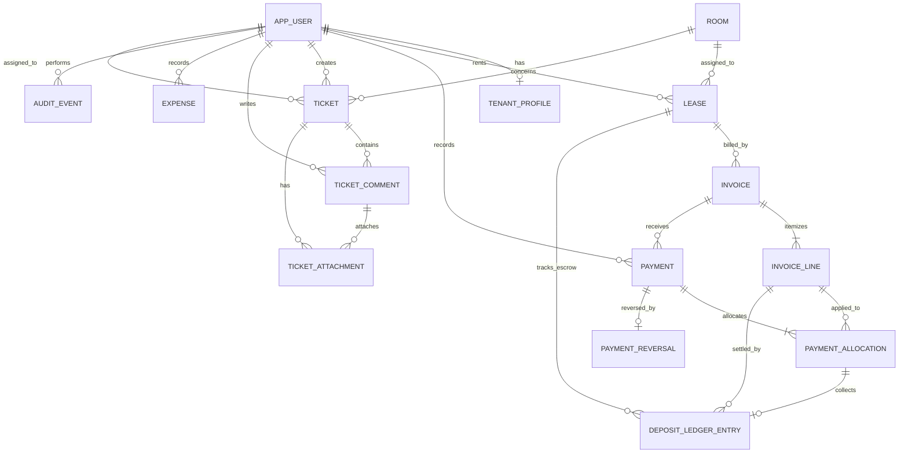

# Draft ERD dan Kontrak Operasi M05 — RumaKost

> Status: Rancangan ERD dan kontrak operasi logis ini ditinjau dalam technical sign-off M05 pada 2026-10-31. Dokumen ini bukan migrasi database atau implementasi API; constraint fisik dan verifikasi runtime dikerjakan pada M06. Scope mengikuti `docs/pm/SCOPE_STATEMENT.md` dan `M05-TECHNICAL-SPEC-DRAFT.md`.

## 1. Batas rancangan

- Satu properti demo, tiga role aplikasi (`OWNER`, `STAFF`, `TENANT`), tidak ada public sign-up.
- Database menyimpan data operasional dan jejak audit; auth provider menyimpan kredensial dan sesi.
- Pembayaran tidak memindahkan uang. Tidak ada integrasi bank/payment gateway.
- Deposit escrow termasuk dalam slice P0 berdasarkan WF-03/WF-04/WF-05/WF-06/WF-10 dan E2E Alur 1 & 5. Model mendukung nilai default kamar, nilai kontrak, komponen invoice awal, saldo escrow, settlement ke tagihan, dan rekonsiliasi check-out. Prorata dan mode satu bulan penuh berbasis tanggal masuk sama-sama didukung sesuai WF-04/WF-05. Keputusan sebelumnya untuk tanpa prorata/due day per kontrak digantikan oleh arahan pemilik agar M05 mengikuti M04. Denda umum, diskon tahunan, meteran utilitas, izin tamu, renewal mandiri, akun teknisi, OTP/2FA, rating, dan ekspor lanjutan tetap di luar P0 kecuali scope diubah.
- Semua nilai uang disimpan sebagai `NUMERIC(14,2)` atau representasi Decimal setara; API mengirim nominal sebagai string desimal agar presisi tidak hilang.
- Tanggal kalender disimpan sebagai `DATE`; timestamp audit disimpan UTC. Zona tampilan: `Asia/Jakarta`.
- **Arahan pemilik terbaru 2026-10-30:** wireframe/runbook M04 menjadi sumber aturan billing: mode prorata sampai akhir bulan atau satu bulan kalender penuh pada siklus tanggal masuk. Keputusan no-prorata dan due day per kontrak yang disampaikan sebelumnya digantikan.
- **Arahan pemilik 2026-10-30:** deposit escrow dicakup seperti alur check-in, invoice pertama, settlement, dan check-out yang ada di M04.
- **Penyelarasan role terhadap M04:** Owner/Staff berizin dapat membuat kontrak dan mencatat pengeluaran; Penghuni dapat mengajukan check-out; Owner melakukan inspeksi dan menyetujui rekonsiliasi finansial deposit. Staff dapat mencatat payment `PENDING`, tetapi tidak mengubah kontrak aktif, mengesahkan pembayaran, atau melihat laporan finansial.

## 2. Model data logis

### Entitas dan constraint utama

| Entitas | Kolom inti (usulan) | Constraint/invarian |
|---|---|---|
| `AppUser` | `id UUID`, `authSubject UNIQUE`, `emailNormalized UNIQUE`, `displayName`, `phone?`, `role`, `isActive`, `mustChangePassword`, `createdBy?`, timestamps | `authSubject` menunjuk identitas provider; email dinormalisasi; role hanya tiga role MVP; tidak menyimpan password/token sesi. |
| `TenantProfile` | `userId PK/FK`, `emergencyContact?` | Profil tenant hanya memuat data minimum sintetis yang diperlukan MVP. Nomor kendaraan/kontak tambahan dari mockup belum otomatis masuk scope. |
| `Room` | `id UUID`, `code UNIQUE`, `floor`, `roomType?`, `monthlyRent NUMERIC`, `depositDefaultAmount NUMERIC`, `physicalStatus`, timestamps | Kode kamar unik; default deposit terisi 50% tarif bulanan menurut WF-03 dan dapat diedit Owner; pada kontrak dapat diubah atau diset nol; status fisik dipisahkan dari okupansi; tidak boleh menghapus kamar yang dirujuk histori. |
| `Lease` | `id UUID`, `tenantUserId FK`, `roomId FK`, `startsOn DATE`, `endsOn DATE?`, `rentAmount NUMERIC`, `depositAgreedAmount NUMERIC`, `billingMode ENUM`, `status`, `createdBy FK`, timestamps | `endsOn > startsOn`; satu kamar tidak punya dua lease aktif bertabrakan; `billingMode` adalah `PRORATA_TO_MONTH_END` atau `FULL_MONTH_ANNIVERSARY`; nominal deposit kontrak dapat nol; perubahan tidak menghapus histori. |
| `LeaseEndRequest` | `id UUID`, `leaseId FK`, `requestedByTenantId FK`, `requestedEndOn DATE`, `reason?`, `status`, `reviewedByOwnerId? FK`, `reviewedAt?`, timestamps | Penghuni hanya dapat meminta check-out untuk lease miliknya; Owner meninjau/menentukan tanggal akhir dan menjalankan inspeksi serta rekonsiliasi deposit. |
| `Invoice` | `id UUID`, `leaseId FK`, `periodStart DATE`, `periodEnd DATE`, `dueOn DATE`, `kind`, `amountDue NUMERIC`, `issuedAt`, `deliveryStatus`, `voidedAt?`, timestamps | Invoice berisi satu atau lebih line; unique lease/periode/jenis mencegah duplikasi; total sama dengan jumlah line; status dibayar/parsial/terlambat diturunkan dari alokasi pembayaran terverifikasi/reversal. |
| `InvoiceLine` | `id UUID`, `invoiceId FK`, `kind ENUM(RENT, DEPOSIT)`, `description`, `amount NUMERIC`, `periodStart?`, `periodEnd?` | Nilai positif; invoice awal dapat punya line sewa dan deposit terpisah; deposit bukan pendapatan sewa. Jenis biaya lain belum masuk P0. |
| `Payment` | `id UUID`, `invoiceId FK`, `amount NUMERIC`, `method`, `status`, `recordedBy FK`, `verifiedBy? FK`, `verifiedAt?`, `rejectedBy? FK`, `rejectedAt?`, `reference?`, timestamps | `amount > 0`; hanya `VERIFIED` berdampak ke saldo; hanya Owner memverifikasi/menolak; Staff tidak dapat memverifikasi catatannya sendiri. |
| `PaymentAllocation` | `id UUID`, `paymentId FK`, `invoiceLineId FK`, `amount NUMERIC` | Alokasi positif; jumlah alokasi per payment harus sama dengan amount pembayaran; total payment tidak boleh melebihi saldo terbuka invoice saat verifikasi; tidak ada credit balance/surplus; deposit dianggap terkumpul hanya dari alokasi terverifikasi ke line deposit. |
| `DepositLedgerEntry` | `id UUID`, `leaseId FK`, `invoiceLineId? FK`, `kind ENUM(COLLECTED, APPLIED_TO_RENT, WITHHELD_AT_CHECKOUT, REFUNDED)`, `amount NUMERIC`, `paymentAllocationId? UNIQUE FK`, `reason?`, `refundStatus?`, `createdBy FK`, timestamps | Append-only; amount positif; saldo turunan = terkumpul − settlement − withholding − refund; saldo tidak boleh negatif. `COLLECTED` wajib menunjuk alokasi payment line deposit; `APPLIED_TO_RENT` menunjuk line sewa. Refund/pemotongan butuh alasan; refund ditandai antrean/pencairan manual, tanpa transfer otomatis. |
| `PaymentReversal` | `id UUID`, `paymentId UNIQUE FK`, `amount NUMERIC`, `reason`, `createdBy OWNER FK`, `createdAt` | Maksimal satu reversal penuh per pembayaran terverifikasi pada MVP; tidak mengubah/menghapus payment asal; saldo dihitung tepat satu kali. |
| `Expense` | `id UUID`, `category`, `amount NUMERIC`, `occurredOn DATE`, `description`, `recordedBy FK`, timestamps | Nominal positif; menjadi arus kas keluar F-06; Owner/Staff berizin dapat mencatat, hanya Owner dapat melihat laporan agregat. |
| `Ticket` | `id UUID`, `roomId FK`, `createdBy FK`, `assignedTo? FK`, `title`, `description`, `priority`, `status`, `closedAt?`, `reopenedAt?`, timestamps | Tenant hanya dapat membuat tiket pada lease aktif/relasi kamar miliknya; status memakai lima tahap M04; waktu tutup menjadi awal retensi media. |
| `TicketComment` | `id UUID`, `ticketId FK`, `authorId FK`, `body`, `visibility`, `createdAt` | `visibility` adalah `TENANT_VISIBLE` atau `INTERNAL`; hanya Owner/Staff boleh membuat catatan internal; tenant tak pernah menerima isi internal. |
| `TicketAttachment` | `id UUID`, `ticketId FK`, `commentId? FK`, `uploadedBy FK`, `objectKey UNIQUE`, `mimeType`, `sizeBytes`, `durationSeconds?`, `uploadStatus`, `createdAt`, `deleteAfter?`, `deletedAt?` | Objek privat; ticket/comment harus merujuk tiket sama; validasi ukuran/MIME/durasi di server; agregat satu tiket maks 40 MB; initial submit wajib ≥1 foto/video. |
| `AuditEvent` | `id UUID`, `actorId FK?`, `action`, `entityType`, `entityId`, `occurredAt`, `reason?`, `safeMetadata JSON` | Append-only untuk aksi sensitif (role, kontrak, invoice, pembayaran, reversal, akses/retensi media); tidak menyalin password, token, bukti transfer, atau signed URL. |

`Invoice` dan `DepositLedgerEntry` tidak menyimpan saldo berjalan. Saldo invoice diturunkan dari line invoice, alokasi pembayaran terverifikasi, dan reversal. Saldo escrow diturunkan dari ledger deposit. Verifikasi/reversal pembayaran, alokasi line, perubahan saldo escrow terkait, dan audit event harus berada dalam satu transaksi database.

### Aturan siklus tagihan yang dipilih

- Lease menyimpan mode billing yang dipilih saat check-in. `PRORATA_TO_MONTH_END`: invoice awal menghitung tanggal masuk sampai akhir bulan secara inklusif dengan rumus `monthlyRent × billableDays / daysInMonth`, dibulatkan ke ribuan terdekat seperti contoh WF-05; invoice rutin berikutnya memakai bulan kalender dan jatuh tempo tanggal 1. `FULL_MONTH_ANNIVERSARY`: invoice awal menagih sewa satu bulan penuh; invoice rutin selanjutnya jatuh tempo pada tanggal masuk tiap bulan, dengan tanggal diklem ke hari terakhir bulan yang lebih pendek.
- Invoice pertama jatuh tempo saat check-in/penerbitan. Invoice rutin berisi line sewa. Deposit menjadi line invoice pertama dan dipisahkan dari pendapatan sewa; deposit baru menambah saldo escrow setelah alokasi pembayaran terverifikasi pada line deposit. Due date manual pada invoice on-demand tidak boleh mendahului tanggal terbit.
- `runInvoiceGeneration(localDate)` berjalan harian di `Asia/Jakarta`, menghasilkan invoice yang jatuh tempo menurut mode masing-masing lease aktif. Kunci idempotensi adalah lease + batas periode + jenis invoice. Pembuatan ulang aman dan Owner dapat meminta rerun dengan audit sumber.
- On-demand invoice di WF-05 dapat menerima due date manual. Dua mode billing di atas berlaku untuk check-in/recurring; on-demand non-sewa dan blast WhatsApp tetap mengikuti batas P0/out-of-scope yang ditetapkan Scope Statement.
- **Alokasi pembayaran parsial (disetujui Owner, 2026-10-30):** alokasikan ke line sewa terlebih dahulu, lalu deposit. Simpan tiap alokasi; hanya alokasi terverifikasi ke line deposit yang menambah saldo escrow.

## 3. Status domain

- Lease: `SCHEDULED`, `ACTIVE`, `ENDED`, `CANCELLED`. Aturan transisi dan sumber waktu aktif perlu konsisten dengan tanggal kalender yang dipilih.
- Invoice: status operasional tersimpan `ISSUED` atau `VOID`; status tampilan `UNPAID`, `PARTIAL`, `PAID`, `OVERDUE` diturunkan. Invoice void yang memiliki pembayaran terverifikasi memerlukan koreksi dahulu.
- Payment: `PENDING`, `VERIFIED`, `REJECTED`; reversal terpisah, bukan status yang menghapus status `VERIFIED` asal.
- Room physical status: `READY`, `CLEANING`, `MAINTENANCE`; okupansi diturunkan dari lease aktif. Daftar akhir perlu diselaraskan dengan state prototipe sebelum schema lock.
- Ticket: `RECEIVED`, `ASSIGNED`, `IN_PROGRESS`, `INSPECTION`, `RESOLVED`; `REOPENED` dapat direpresentasikan sebagai status/timestamp setelah keputusan status akhir disahkan.
- Ticket priority: `LOW`, `NORMAL`, `URGENT`.
- Ticket attachment: `PENDING_UPLOAD`, `AVAILABLE`, `DELETE_PENDING`, `DELETED`, `FAILED`.

## 4. Matriks izin minimum

| Operasi/data | Owner | Staff | Tenant |
|---|---|---|---|
| Login | Akun diaktifkan | Akun diaktifkan Owner | Akun diaktifkan Owner |
| Kamar | CRUD | Lihat dan update status operasional | Lihat kamar/lease sendiri |
| Tenant/lease | CRUD, check-in, inspeksi/terminasi dan rekonsiliasi | Buat/check-in kontrak dan lihat data operasional; tak mengubah syarat kontrak aktif atau menyetujui check-out finansial | Lihat milik sendiri; mengajukan check-out |
| Invoice | Terbitkan/koreksi status operasional | Lihat dan tandai penyampaian manual | Lihat milik sendiri |
| Payment | Catat, verifikasi, tolak, reversal | Catat `PENDING`; tak dapat verifikasi | Catat klaim milik sendiri sebagai `PENDING` |
| Expense/report | CRUD dan laporan finansial | Membuat catatan pengeluaran; tidak dapat membuka laporan finansial | Tidak ada |
| Ticket/comment | Lihat/kelola seluruh tiket; komentar internal | Lihat/kelola tiket operasional; komentar internal | Buat tiket kamar sendiri; komentar terlihat tenant; baca tiket sendiri |
| Attachment | Akses sesuai tiket | Akses sesuai tiket yang berwenang | Hanya lampiran tiket miliknya yang tenant-visible |
| Audit events | Baca seluruh event | Tidak | Tidak |

RBAC ditegakkan di fungsi akses data/server action/route handler, bukan hanya di menu UI. Setiap query tenant menyertakan kepemilikan/lease; setiap akses berkas mengulang pemeriksaan tiket sebelum URL ditandatangani.

## 5. Kontrak operasi aplikasi

Operasi berikut adalah kontrak logis; bentuk transport final bisa Server Actions untuk UI internal dan Route Handlers untuk upload URL. Semua operasi mutasi menerima idempotency key bila retry dapat menggandakan hasil finansial atau tiket.

| Operasi | Role | Input minimum | Hasil / error domain penting |
|---|---|---|---|
| `createRoom` / `updateRoom` | Owner; Staff hanya status yang diizinkan | code, floor, rent, physicalStatus | Room; `ROOM_CODE_TAKEN`, `ROOM_IN_USE`, `VALIDATION_ERROR` |
| `createLease` | Owner/Staff berizin | tenant, room, start date, agreed rent, deposit, billing mode | Lease + invoice awal; `ROOM_CONFLICT`, `INVALID_DATES`, `TENANT_INACTIVE` |
| `requestLeaseEnd` | Tenant pada lease miliknya | leaseId, requestedEndOn, optional reason | Permintaan check-out `PENDING`; `LEASE_NOT_OWNED`, `LEASE_ALREADY_ENDED` |
| `endLease` / `reconcileCheckoutDeposit` | Owner | leaseId, actual end date; refund/deduction mode, amount, reason | Lease berakhir + rekonsiliasi deposit; `LEASE_NOT_ACTIVE`, `DEPOSIT_INSUFFICIENT`, `REASON_REQUIRED` |
| `runInvoiceGeneration(localDate)` | Scheduler internal; Owner boleh meminta rerun | tanggal lokal `Asia/Jakarta` | invoice due sesuai mode lease; jumlah invoice baru/duplikat; idempotent; audit source scheduler/rerun |
| `markInvoiceDelivered` | Owner/Staff | invoiceId, channel `MANUAL`, timestamp | status penyampaian; tak mengirim pesan otomatis |
| `recordPayment` | Owner/Staff/Tenant (resource-owned, Tenant hanya lease aktif) | invoiceId, amount string, method, optional reference | Payment `PENDING`; amount di atas saldo terbuka ditolak; `INVOICE_NOT_OWNED`, `AMOUNT_INVALID`, `INVOICE_CLOSED`, `LEASE_ENDED`, `OVERPAYMENT` |
| `verifyPayment` / `rejectPayment` | Owner | paymentId, decision, rejection reason? | Payment status, recalculated balance, AuditEvent; validasi atomik memastikan amount tidak melebihi saldo invoice saat itu; `NOT_OWNER`, `PAYMENT_NOT_PENDING`, `SELF_APPROVAL`, `OVERPAYMENT` |
| `reversePayment` | Owner | paymentId, reason | Reversal penuh + balance recalculation atomically; `REASON_REQUIRED`, `NOT_VERIFIED`, `ALREADY_REVERSED` |
| `settleInvoiceFromDeposit` | Owner | invoiceLineId RENT, amount, reason? | Entry `APPLIED_TO_RENT` + saldo invoice/escrow atomik; `DEPOSIT_INSUFFICIENT`, `INVOICE_CLOSED`, `AMOUNT_INVALID` |
| `reconcileCheckoutDeposit` | Owner | leaseId, refund/deduction mode, amount, reason | `WITHHELD_AT_CHECKOUT` dan/atau refund manual `PENDING`; total tidak melebihi saldo escrow; `LEASE_NOT_ENDED`, `DEPOSIT_INSUFFICIENT`, `REASON_REQUIRED` |
| `recordExpense` | Owner/Staff berizin | category, amount string, date, description | Expense; `AMOUNT_INVALID` |
| `getFinancialReport` | Owner | date range | pemasukan neto, pengeluaran, okupansi; `FORBIDDEN` |
| `createTicket` | Tenant pada lease aktif miliknya | room, title, description, urgency, attachment batch | Ticket `RECEIVED`; `ROOM_NOT_OWNED`, `LEASE_NOT_ACTIVE`, `MEDIA_REQUIRED`, `MEDIA_LIMIT_EXCEEDED` |
| `updateTicket` / `assignTicket` | Owner/Staff | ticketId, status/priority/assignee | Ticket + audit/status event; `TICKET_NOT_FOUND`, `INVALID_TRANSITION` |
| `addTicketComment` | Owner/Staff; Tenant hanya pada tiket sendiri selama lease aktif | ticketId, body, visibility | Comment; tenant pascakontrak read-only dan tidak dapat komentar; tenant cannot set `INTERNAL`; `TICKET_NOT_OWNED`, `LEASE_ENDED`, `FORBIDDEN_VISIBILITY` |
| `createUploadIntent` | Owner/Staff berizin atau Tenant pemilik tiket selama lease aktif | ticketId, metadata, size/type | opaque object key + short-lived signed upload URL; Tenant pascakontrak tidak dapat upload; `FORBIDDEN`, `LEASE_ENDED`, `INVALID_MEDIA`, `TICKET_LIMIT_EXCEEDED` |
| `finalizeUpload` / `requestAttachment` | Authorized ticket participant | attachmentId | available attachment / short-lived signed download URL; `UPLOAD_INCOMPLETE`, `FORBIDDEN` |

Common behavior: unauthenticated `401`; authenticated but unauthorized `403` (or `404` bila perlu mencegah enumerasi resource); input tidak valid `400`; konflik idempotensi/unique `409`; kegagalan provider `503` dengan retry aman. Jangan mengembalikan SQL detail, object key, token provider, atau komentar internal kepada tenant.

## 6. Skenario transaksi dan konsistensi

1. **Verifikasi bayar:** kunci row pembayaran, pastikan `PENDING`, pastikan actor Owner, ubah ke `VERIFIED`, isi verifier/time, tulis audit, commit sekali. Retry kedua mengembalikan status kini dan tidak mengurangi saldo lagi.
2. **Reversal:** kunci payment, pastikan `VERIFIED` dan belum pernah direversal; simpan reversal penuh dengan alasan, audit event, dan commit. Payment asal tetap tidak berubah.
3. **Generate invoice:** unique constraint lease/periode/mode + transaction/upsert membuat proses aman diulang; prorata/anniversary memakai kalkulasi tanggal yang konsisten dan tidak membuat invoice untuk kontrak yang belum eligible.
4. **Escrow:** verifikasi alokasi ke line deposit membuat `COLLECTED`; settlement mengunci lease/ledger dan invoice line, memeriksa saldo tersedia, menulis event ledger dan melunasi saldo line sewa secara atomik. Check-out mengunci saldo, menolak refund/potongan melebihi saldo, lalu mencatat alasan dan status antrean refund manual.
5. **Kirim ticket dengan lampiran:** buat batch upload terbatas; server verifikasi objek dan agregat sebelum mengubah ticket ke `RECEIVED`. Jika gagal, hapus objek sementara lewat cleanup job.
6. **Tutup ticket:** set `closedAt`, hitung `deleteAfter = closedAt + 365 days`. Jika reopened, hapus jadwal lama dan hitung ulang saat close berikutnya.

## 7. Keputusan domain dan batas schema

- Billing dan deposit mengikuti M04. Alokasi pembayaran parsial disetujui Owner pada 2026-10-30: sewa lebih dahulu, kemudian deposit; simpan alokasi per line secara atomik saat verifikasi.
- Check-out mengantrekan refund manual; M04 menampilkan data rekening tujuan, tetapi M02 mengecualikan detail rekening dari MVP. Refund surplus pembayaran di luar rekonsiliasi deposit tidak didukung. Rancangan tidak menyimpan nomor rekening dan hanya mencatat jumlah, alasan, serta status refund sampai konflik privasi/scope diubah secara eksplisit.
- Diskon tahunan, denda umum, dan sub-meteran listrik belum masuk model P0; hanya potongan deposit untuk kerusakan/tunggakan pada rekonsiliasi check-out yang dicakup.
- Batas crosswalk M04/M02: satu Tenant per Lease; tidak ada roommate/multi-kamar/mutasi kamar, credit balance, overpayment, refund surplus umum, carry-over tunggakan, biaya insidental, data rekening, properti editable, tata tertib dinamis, permission Staff granular, atau akun Teknisi. Invoice hanya RENT/DEPOSIT; overpayment ditolak, tunggakan tetap pada invoice asal, Expense berdiri sendiri, dan tiket hanya dibuat Tenant pada lease aktif.
- Matriks izin Staff mengikuti M04: Owner/Staff berizin dapat membuat kontrak dan mencatat pengeluaran; Staff tidak mengubah syarat kontrak aktif, mengesahkan pembayaran, atau melihat laporan keuangan. Penghuni mengajukan check-out; Owner menginspeksi dan mengesahkan rekonsiliasi deposit.
- Pascakontrak, Tenant dapat membaca histori kontrak, invoice, dan tiket miliknya saja; semua mutasi dan unggah baru ditolak, termasuk klaim pembayaran. Pemeriksaan kepemilikan tetap berlaku pada setiap query.
- Seed demo menyertakan satu akun Staff sintetis; jangan menyalin kredensial contoh dari runbook M04.
- Media menerima foto JPEG/PNG/WebP dan video MP4/MOV; server memeriksa signature/konten dan MIME aktual.
- Operasi gratis menerima scale-to-zero; Vercel Hobby Cron berjalan sekali sehari; Neon Free PITR memiliki batas histori 6 jam/1 GB.
- Apakah Owner boleh memverifikasi pembayaran yang ia catat sendiri? Frozen Scope memberi Owner wewenang verifikasi; zero self-approval hanya melarang Staff. Baseline mengizinkan Owner dengan audit trail.

## 8. Acceptance gate untuk ERD/API

- [ ] Setiap kolom dan relasi memiliki pemilik data, role access, retention, serta aturan validasi yang jelas.
- [ ] Constraint database mencegah duplikasi invoice, kontrak kamar bertabrakan, dan reversal ganda.
- [ ] Tidak ada saldo yang dimutasi secara terpisah dari event pembayaran/reversal.
- [ ] Setiap operasi memiliki role, ownership check, input/output, error, transaksi, dan idempotensi yang terdokumentasi.
- [ ] Negative access cases tenant/Staff diuji di level server dan database/query.
- [ ] Retensi media, upload orphan, signed URL, dan batas storage provider terdokumentasi.
- [x] Rule alokasi pembayaran parsial disetujui Owner pada 2026-10-30: sewa lebih dahulu, lalu deposit.
- [ ] Scheduler harian menggunakan zona `Asia/Jakarta`, mendukung prorata dan anniversary, dapat diulang, dan mengaudit invoice baru/duplikat/gagal.

