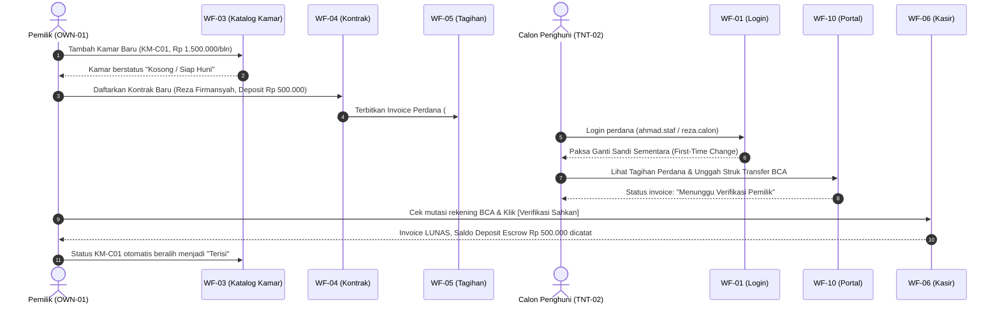
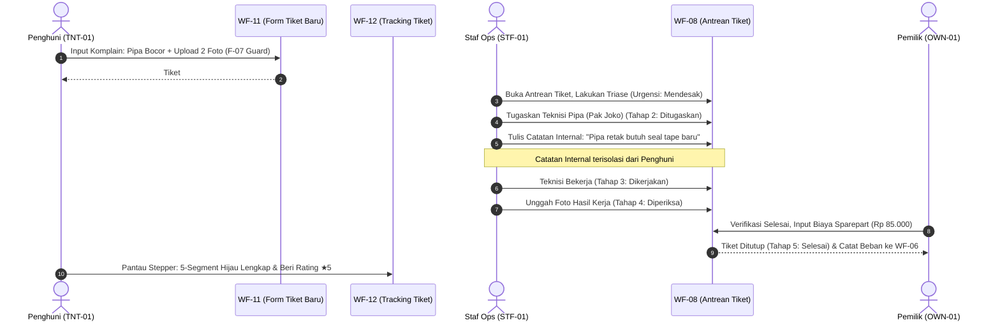
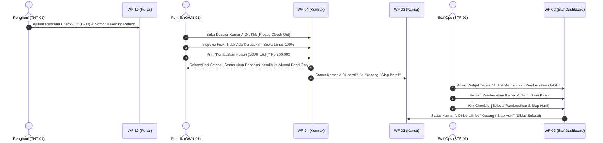

# MASTER RUNBOOK: SKENARIO PENGUJIAN END-TO-END (E2E) LINTAS PERAN
## Sistem Manajemen Kost Mandiri (RumaKost)

> **Modul**: M04 · UI/UX & Prototyping (Transisi ke M05 Arsitektur Teknis / M06 Implementasi Frontend & Backend)  
> **Tujuan**: Panduan pengujian integrasi terpadu (*Master E2E Lifecycle Walkthrough*) yang menghubungkan 3 peran pengguna (**Pemilik / Owner**, **Staf Pengelola / Staff**, dan **Penghuni / Tenant**) secara berkesinambungan tanpa putus alur bisnis.  
> **Acuan Inti**: [`docs/pm/SCOPE_STATEMENT.md`](file:///D:/Workspace/rumakost/docs/pm/SCOPE_STATEMENT.md) (Intake Success Metric: 6 Alur Utama), [`DESIGN.md`](file:///D:/Workspace/rumakost/DESIGN.md), dan [`SITEMAP.md`](file:///D:/Workspace/rumakost/docs/design/SITEMAP.md).  
> **Standar UI/UX**: Estify Design DNA (WCAG 2.2 AA, Zero Emoji / 100% Lucide Icons, Status Triad Semantik, Tabular Number `tnum`).

---

## 1. Matriks Aktor & Kredensial Uji Fixture Terpadu

| ID Aktor | Peran Sistem | Nama Uji | Email & Kredensial | Rute Awal Masuk | Wewenang Khusus & Batasan |
|---|---|---|---|---|---|
| **OWN-01** | **Pemilik (Owner)** | Budi Santoso | `budi.santoso@rumakost.id`<br>`password123` | [`WF-02-dashboard.html`](file:///D:/Workspace/rumakost/docs/design/screens/WF-02-dashboard.html) | **Superadmin (Akses Penuh 1 Properti)**: Verifikasi transaksi bank tunggal, aktivasi akun, lihat laporan laba bersih & arus kas. |
| **STF-01** | **Staf Pengelola (Staff)** | Rini Setiawati | `rini.operasional@rumakost.id`<br>`password123` | [`WF-02-staf-dashboard.html`](file:///D:/Workspace/rumakost/docs/design/screens/WF-02-staf-dashboard.html) | **Operasional Lapangan**: Catat meteran PLN, catat titipan kas (*Zero Self-Approval*), triase tiket kerusakan, checklist kebersihan kamar. Dilarang buka laporan keuangan. |
| **TNT-01** | **Penghuni Utama** | Budi Santoso (Penyewa) | `budi.penghuni@rumakost.id`<br>`password123` | [`WF-10-portal-penghuni.html`](file:///D:/Workspace/rumakost/docs/design/screens/WF-10-portal-penghuni.html) | **Penyewa Kamar A-04**: Akses mandiri tagihan kamar, konfirmasi transfer mandiri, lapor komplain wajib foto/video. |
| **TNT-02** | **Calon Penghuni Baru** | Reza Firmansyah | `reza.calon@rumakost.id`<br>`RumaKost#2026!` | [`WF-01-login.html`](file:///D:/Workspace/rumakost/docs/design/screens/WF-01-login.html) | **Penyewa Kamar C-01**: Akun baru dengan kata sandi sementara, simulasi check-in perdana. |
| **TNT-03** | **Penghuni Multi-Unit** | Hendra Kusuma | `hendra.multi@rumakost.id`<br>`password123` | [`WF-10-portal-penghuni.html?multi=true`](file:///D:/Workspace/rumakost/docs/design/screens/WF-10-portal-penghuni.html?multi=true) | **Penyewa Kamar A-04 & A-05**: Simulasi pembayaran tagihan ganda dan perpindahan unit konteks (*unit switcher*). |

---

## 2. Peta Alur Estafet Bisnis (Cross-Role Lifecycle Map)

```
┌────────────────────────────────────────────────────────────────────────────────────────────────────────┐
│                              ENAM ALUR ESTAFET BISNIS UTAMA RUMAKOST                                   │
├────────────────────────────────────────────────────────────────────────────────────────────────────────┤
│ ALUR 1: ONBOARDING & TAGIHAN PERDANA                                                                   │
│ [Owner: Buat Kamar WF-03] ──► [Owner/Staf: Buat Kontrak WF-04] ──► [Invoice Perdana Sewa+DP WF-05]    │
│ ──► [Penghuni: First-Login & Bayar WF-10] ──► [Owner: Verifikasi Mutasi Bank WF-06] ──► [Kamar Terisi] │
├────────────────────────────────────────────────────────────────────────────────────────────────────────┤
│ ALUR 2: SIKLUS TAGIHAN BULANAN, METERAN PLN, & CICILAN PARSIAL                                         │
│ [Staf: Catat kWh PLN WF-05] ──► [Sistem: Tagihan Bulanan Terbit] ──► [Penghuni: Titip Kas ke Staf]     │
│ ──► [Staf: Input Kas Masuk Status Pending WF-06] ──► [Owner: Approve & Hitung Sisa Saldo WF-06]       │
├────────────────────────────────────────────────────────────────────────────────────────────────────────┤
│ ALUR 3: KOMPLAIN KERUSAKAN, TRIASE LAPANGAN, & PENYELESAIAN BIAYA                                      │
│ [Penghuni: Buat Tiket + Bukti Foto WF-11] ──► [Staf: Triase & Catatan Internal WF-08]                 │
│ ──► [Staf: Update Tahap Pengerjaan WF-08/12] ──► [Owner: Tutup Tiket & Catat Biaya Operasional WF-08]  │
├────────────────────────────────────────────────────────────────────────────────────────────────────────┤
│ ALUR 4: PENGELUARAN RUTIN OPERASIONAL & LAPORAN ARUS KAS EKSEKUTIF                                     │
│ [Staf/Owner: Catat Biaya WiFi / Listrik WF-06] ──► [Owner: Audit Arus Kas & Okupansi Riil WF-07]      │
├────────────────────────────────────────────────────────────────────────────────────────────────────────┤
│ ALUR 5: PENGAKHIRAN SEWA (CHECK-OUT), SETTLEMENT DEPOSIT, & TURNOVER PEMBERSIHAN KAMAR                 │
│ [Penghuni: Pengajuan Check-Out WF-10] ──► [Owner: Inspeksi & Rekonsiliasi Refund Deposit WF-04/06]     │
│ ──► [Status: Kosong/Siap Bersih] ──► [Staf: Checklist Pembersihan & Set Kamar Siap Huni WF-02/03]     │
├────────────────────────────────────────────────────────────────────────────────────────────────────────┤
│ ALUR 6: PENGHUNI MULTI-KAMAR & JURNAL REVERSAL KOREKSI SALAH CATAT                                     │
│ [Penghuni: Bayar Tagihan Multi-Unit WF-10] ──► [Staf/Owner: Penanganan Salah Nominal Kas]              │
│ ──► [Owner: Eksekusi Jurnal Reversal Transparan WF-06] ──► [Saldo Tagihan Dipulihkan Otomatis]         │
└────────────────────────────────────────────────────────────────────────────────────────────────────────┘
```

---

## 3. Rincian Langkah Pengujian 6 Alur Utama End-to-End

---

### ALUR 01: Onboarding Kamar, Pendaftaran Kontrak Baru, & Verifikasi Tagihan Perdana
* **Tujuan**: Memastikan alur pembukaan unit baru hingga penghuni menempati kamar dan membayar deposit jaminan berjalan mulus tanpa celah duplikasi kontrak.
* **Peran Terlibat**: Pemilik (`OWN-01`) $\rightarrow$ Calon Penghuni (`TNT-02`) $\rightarrow$ Pemilik (`OWN-01`).



* **Langkah Verifikasi**:
  1. **Owner (`WF-03`)**: Buka modal `#modalTambahKamar`, masukkan nomor unit `C-01`, tipe `Deluxe AC`, tarif `Rp 1.500.000`, deposit `Rp 500.000`. Simpan data.
  2. **Owner (`WF-04`)**: Buka `#modalTambahPenghuni`, pilih unit `C-01`, isi nama `Reza Firmansyah`, nomor WhatsApp `081298765432`, durasi 12 bulan. Sistem otomatis mengunci kamar dan memicu terbitnya Invoice Perdana gabungan:
     $$\text{Total Invoice} = \text{Sewa Bulan 1 (Rp 1.500.000)} + \text{Deposit Escrow (Rp 500.000)} = \text{\bf Rp 2.000.000}$$
  3. **Calon Penghuni (`WF-01` & `WF-10`)**:
     - Login menggunakan `reza.calon@rumakost.id` dengan sandi sementara `RumaKost#2026!`.
     - Modal aktivasi kata sandi terbuka otomatis; masukkan kata sandi baru pribadi.
     - Portal menyajikan hitung mundur masa sewa serta rincian tagihan perdana `#INV-202611-C01`.
     - Klik tombol **"Konfirmasi Pembayaran Transfer"**, unggah bukti struk transfer BCA, dan klik kirim.
  4. **Owner (`WF-06`)**:
     - Masuk ke tab **"Menunggu Verifikasi"**.
     - Temukan transaksi Reza Firmansyah sebesar `Rp 2.000.000`.
     - Buka modal periksa slip bukti transfer, lalu klik tombol **"Sahkan Pembayaran (Approve)"**.
  5. **Kriteria Sukses**:
     - Tagihan berstatus `LUNAS` di `WF-05` dan `WF-10`.
     - Kuitansi resmi digital `DOC-01` terbit dengan watermark LUNAS.
     - Kamar C-01 di `WF-03` berubah status menjadi **"Terisi"** dan tidak dapat menerima kontrak kedua (*collision prevented*).
     - Saldo jaminan `Rp 500.000` masuk ke pos *Escrow Tracking* tanpa dihitung sebagai laba pendapatan kotor murni.

---

### ALUR 02: Siklus Tagihan Bulanan, Sub-Meteran Listrik, & Pembayaran Parsial (Zero Self-Approval)
* **Tujuan**: Menguji penagihan bulanan berulang, pencatatan sub-meteran kWh mandiri, pembayaran cicilan bertahap oleh penghuni, dan penegakan wewenang *Zero Self-Approval* staf.
* **Peran Terlibat**: Staf (`STF-01`) $\rightarrow$ Penghuni (`TNT-01`) $\rightarrow$ Staf (`STF-01`) $\rightarrow$ Pemilik (`OWN-01`).

* **Langkah Verifikasi**:
  1. **Staf Lapangan (`WF-05` / `SCR-09M`)**:
     - Staf Rini membuka modal pencatatan sub-meteran bulanan untuk Kamar A-04.
     - Angka meteran bulan lalu: `1.240 kWh`, angka meteran kini: `1.390 kWh` (pemakaian `150 kWh`).
     - Kuota gratis kost: `100 kWh`. Selisih kelebihan: `50 kWh` $\times$ `Rp 2.000/kWh` = `Rp 100.000`.
     - Sistem menambahkan biaya listrik sub-meteran ke dalam invoice berjalan Kamar A-04:
       $$\text{Total Tagihan} = \text{Sewa Pokok (Rp 1.500.000)} + \text{Sampah (Rp 50.000)} + \text{Listrik (Rp 100.000)} = \text{\bf Rp 1.650.000}$$
  2. **Penghuni (`TNT-01`)**:
     - Menerima rincian tagihan di `WF-10`. Memutuskan membayar tunai secara bertahap (cicilan ke-1) sebesar `Rp 1.000.000` dengan menitipkan kas ke Staf Rini di pos operasional.
  3. **Staf Pengelola (`WF-06`) — Penegakan Zero Self-Approval**:
     - Staf Rini membuka `WF-06` dengan parameter peran `?role=staf`.
     - Klik tombol **"+ Catat Pembayaran Masuk"**.
     - Masukkan unit `Kamar A-04`, kanal `Tunai (Kas Staf)`, nominal `Rp 1.000.000`.
     - Klik **"Simpan Catatan Kas"**.
     - **Pemeriksaan Keamanan**: Transaksi otomatis terkunci dengan badge oranye: **"Pending Verifikasi Owner"**. Tombol *Approve / Tolak* disembunyikan/dinonaktifkan bagi akun staf. Saldo tagihan Kamar A-04 **belum berkurang** sebelum diverifikasi pemilik.
  4. **Pemilik Properti (`WF-06`)**:
     - Owner Budi login dan menerima uang fisik titipan dari Staf Rini.
     - Owner membuka antrean verifikasi dan menekan tombol **"Verifikasi Penerimaan Kas"**.
  5. **Kriteria Sukses**:
     - Status transaksi berubah menjadi `Terverifikasi`.
     - Tagihan Kamar A-04 di `WF-05` dan `WF-10` otomatis bertransisi ke status **"Dibayar Sebagian (Parsial)"**:
       $$\text{Sisa Piutang Terutang} = \text{Rp 1.650.000} - \text{Rp 1.000.000} = \text{\bf Rp 650.000}$$
     - Di `WF-10`, tombol bayar penghuni otomatis menarik sisa tunggakan `Rp 650.000` untuk pelunasan tahap berikutnya.

---

### ALUR 03: Siklus Komplain Fasilitas, Stepper 5 Tahap, & Pencatatan Biaya Servis
* **Tujuan**: Memastikan alur pelaporan kerusakan fasilitas wajib media (F-07), penugasan teknisi, isolasi catatan internal staf, dan penutupan tiket dengan pencatatan beban biaya operasional.
* **Peran Terlibat**: Penghuni (`TNT-01`) $\rightarrow$ Staf (`STF-01`) $\rightarrow$ Pemilik (`OWN-01`) $\rightarrow$ Penghuni (`TNT-01`).



* **Langkah Verifikasi**:
  1. **Penghuni (`WF-11`)**:
     - Klik tombol **"+ Lapor Kerusakan Baru"** di portal `WF-10`.
     - Pilih kategori `Pipa & Sanitasi Air`, tingkat urgensi `Mendesak (< 2 Jam SLA)`.
     - Tulis judul *"Pipa Wastafel Bocor Deras"* dan uraian kronologi.
     - **Uji Penegakan Guardrail F-07**: Coba klik kirim tanpa melampirkan media; sistem menolak tegas. Unggah berkas `Wastafel_Bocor.jpg` (1.4 MB). Klik **"Kirim Laporan Kerusakan"**.
     - Pengguna otomatis dialihkan ke pelacak `WF-12` dengan stepper aktif di **Tahap 1: Diterima**.
  2. **Staf Pengelola (`WF-08`)**:
     - Membuka tiket `#TK-2026-009` di papan antrean.
     - Mengubah status ke **Tahap 2 (Ditugaskan)** dan memilih teknisi rekanan `Pak Joko (Teknisi Pipa)`.
     - Menambahkan balasan bertanda checkbox **"Catatan Internal (Staff/Owner Only)"**: *"Teknisi meluncur dengan perkiraan biaya suku cadang pipa PVC baru"*.
     - **Pemeriksaan Isolasi**: Buka `WF-12` pada sesi Penghuni; pastikan catatan internal tersebut **sama sekali tidak tampil** di thread obrolan penghuni.
  3. **Pengerjaan & Pemeriksaan Lapangan (`WF-08` / `WF-12`)**:
     - Staf memajukan status ke **Tahap 3 (Dikerjakan)** dan kemudian **Tahap 4 (Diperiksa)** setelah teknisi mengunggah foto perbaikan sambungan pipa selesai.
  4. **Penyelesaian & Pencatatan Biaya oleh Owner (`WF-08`)**:
     - Owner membuka modal `#modalSelesaikanTiket`.
     - Memilih status **Tahap 5 (Selesai)**, mencatat biaya riil penggantian pipa sebesar `Rp 85.000` dan garansi pekerjaan 30 hari.
     - Sistem otomatis mengalirkan pengeluaran `Rp 85.000` ke buku kas operasional di `WF-06` dan memulai masa hitung mundur retensi media 365 hari.
  5. **Penghuni (`WF-12`)**:
     - Seluruh 5 segmen stepper berubah menjadi hijau lengkap (*Completed*).
     - Formulir rating kepuasan muncul; penghuni memberikan ulasan 5 bintang.

---

### ALUR 04: Pengeluaran Operasional Rutin & Laporan Keuangan Eksekutif (Owner-Only)
* **Tujuan**: Memvalidasi integritas pembukuan kas operasional dan pencegahan kebocoran laporan laba bersih kepada staf.
* **Peran Terlibat**: Staf (`STF-01`) $\rightarrow$ Pemilik (`OWN-01`).

* **Langkah Verifikasi**:
  1. **Staf Pengelola (`WF-06`)**:
     - Staf mencatat pembelian rutin token listrik koridor bersama senilai `Rp 200.000` via modal `#modalCatatPengeluaran`.
  2. **Uji Keamanan Akses Staf**:
     - Staf mencoba membuka URL `WF-07-laporan.html` atau mengklik menu Laporan di topbar.
     - **Pemeriksaan Keamanan**: Akses dicegat dengan kode status `403 Forbidden` atau dialihkan paksa kembali ke `WF-02-staf-dashboard.html`. Menu navigasi Laporan disembunyikan secara visual dari topbar staf.
  3. **Pemilik Properti (`WF-07`)**:
     - Owner membuka dasbor eksekutif keuangan di `WF-07`.
     - Filter rentang periode: `01 Oktober 2026 s.d. 31 Oktober 2026`.
     - Sistem menghitung secara presisi:
       * **Total Pemasukan Kas Riil**: Hanya menjumlahkan transaksi sewa yang berstatus *Terverifikasi* (transaksi pending diabaikan).
       * **Total Pengeluaran Operasional**: Mengakumulasi biaya token listrik (`Rp 200.000`), biaya servis pipa Alur 3 (`Rp 85.000`), dan biaya utilitas lainnya.
       * **Laba Bersih Operasional (Net Cash Flow)**:
         $$\text{Laba Bersih} = \text{Total Pemasukan Terverifikasi} - \text{Total Pengeluaran Riil}$$
       * **Tingkat Okupansi Fisik**: Menampilkan keterisian 12 dari 15 kamar (80%) yang dapat ditelusuri langsung ke daftar kontrak aktif.

---

### ALUR 05: Pengakhiran Sewa (Check-Out), Rekonsiliasi Deposit, & Turnover Kamar
* **Tujuan**: Menguji siklus terminasi sewa normal, pengembalian deposit jaminan (escrow refund) bebas nilai negatif, transisi kamar ke status pembersihan, dan penutupan siklus pembersihan oleh staf.
* **Peran Terlibat**: Penghuni (`TNT-01`) $\rightarrow$ Pemilik (`OWN-01`) $\rightarrow$ Staf (`STF-01`).



* **Langkah Verifikasi**:
  1. **Pengajuan Check-out oleh Penghuni (`WF-10`)**:
     - Budi Santoso membuka widget *Rencana Check-Out* di portal `WF-10`.
     - Mengisi tanggal kepindahan efektif `10 November 2026`, alasan pindah tugas dinas luar kota, dan nomor rekening pengembalian deposit BCA `8830-999-888`.
  2. **Eksekusi Check-out & Rekonsiliasi Deposit oleh Owner (`WF-04`)**:
     - Owner membuka lembar kontrak Kamar A-04 di `WF-04` dan mengklik tombol **"Check-out / Pengakhiran Sewa"**.
     - Modal rekonsiliasi `#modalAkhiriSewa` terbuka.
     - **Pemeriksaan Kerusakan**: Hasil inspeksi fisik menunjukkan seluruh inventaris kamar (kasur, AC, remote, dinding) dalam kondisi baik.
     - Owner memilih opsi **"Kembalikan Penuh (100% Utuh)"** senilai `Rp 500.000`.
     - *(Alternatif Kasus Kerusakan)*: Jika terdapat kerusakan jendela senilai `Rp 200.000`, sistem menerapkan pemotongan deposit:
       $$\text{Sisa Refund ke Penyewa} = \text{Deposit (Rp 500.000)} - \text{Ganti Rugi (Rp 200.000)} = \text{\bf Rp 300.000}$$
       *(Aturan Floor Zero Guard: Jika ganti rugi Rp 700.000, sistem membatasi refund maksimal Rp 0 dan tidak bernilai negatif).*
     - Klik **"Konfirmasi Pengakhiran Sewa"**.
  3. **Transisi Hak Akses Penghuni**:
     - Akun Budi Santoso otomatis terkunci ke **Mode Alumni (`?mode=archive`)**: tombol pembayaran dan tombol lapor kerusakan baru dinonaktifkan, namun seluruh riwayat kwitansi masa lalu tetap dapat diunduh.
  4. **Turnover & Penyiapan Kamar oleh Staf (`WF-02-staf-dashboard` / `WF-03`)**:
     - Kamar A-04 otomatis berubah status menjadi **"Kosong / Siap Bersih"** (kuning).
     - Pada dasbor staf (`WF-02-staf-dashboard.html`), kamar A-04 muncul pada kartu prioritas *"Kamar Butuh Pembersihan & Turn-Over"*.
     - Staf Rini membersihkan unit, merapikan fasilitas, dan mengklik tombol checklist **"Tandai Pembersihan Selesai"**.
     - Status Kamar A-04 di `WF-03` resmi beralih kembali menjadi **"Kosong / Siap Huni"** (hijau) dan siap menerima kontrak penyewa berikutnya.

---

### ALUR 06: Pembayaran Multi-Kamar & Jurnal Reversal Koreksi Transaksi Finansial
* **Tujuan**: Memastikan transparansi penanganan penghuni pemegang unit ganda (*multi-room tenant*), serta integritas jejak audit finansial saat terjadi koreksi salah input data kas tanpa menghapus rekam jejak fisik (*non-destructive accounting*).
* **Peran Terlibat**: Penghuni Multi-Unit (`TNT-03`) $\rightarrow$ Staf (`STF-01`) $\rightarrow$ Pemilik (`OWN-01`).

* **Langkah Verifikasi**:
  1. **Penghuni Unit Ganda (`WF-10?multi=true`)**:
     - Hendra Kusuma menyewa 2 kamar sekaligus di lantai yang sama: Kamar A-04 (`Rp 1.500.000`) dan Kamar A-05 (`Rp 1.100.000`).
     - Pada portal `WF-10`, dropdown unit switcher menyajikan opsi peralihan aktif antara `Kamar A-04` dan `Kamar A-05`.
     - **Kebijakan Pembayaran Multi-Unit**: Hendra mentransfer total `Rp 2.600.000` via 1 mutasi bank untuk kedua unit tersebut.
     - Pada portal, Hendra mengonfirmasi pembayaran Kamar A-04 (`Rp 1.500.000`) dan Kamar A-05 (`Rp 1.100.000`) dengan melampirkan referensi slip mutasi bank yang sama.
  2. **Insiden Salah Catat Kas Masuk di Lapangan**:
     - Staf salah memasukkan nominal pembayaran tunai penyewa lain di `WF-06`: tercatat `Rp 1.500.000` padahal uang fisik yang diserahkan penyewa adalah `Rp 150.000`.
     - Transaksi sempat terverifikasi oleh Owner sebelum kekeliruan disadari.
  3. **Penegakan Anti Hard-Delete via Jurnal Reversal (`WF-06`)**:
     - Sistem **menolak keras penghapusan baris data** transaksi dari tabel database.
     - Owner Budi membuka detail transaksi `#TRX-202610-088` dan memilih opsi **"Buat Jurnal Reversal (Koreksi Pembatalan)"**.
     - Modal koreksi mewajibkan pengisian alasan pembatalan: *"Koreksi salah input nominal kas tunai (kelebihan nol)"*.
     - Klik **"Eksekusi Reversal"**.
  4. **Kriteria Sukses**:
     - Transaksi asli `#TRX-202610-088` tetap tersimpan utuh di riwayat pembukuan dengan tanda coret merah.
     - Jurnal pembalik baru `#REV-202610-001` terbit dengan nilai negatif:
       $$\text{Entri Pembalik} = -\text{Rp 1.500.000}$$
     - Saldo piutang tagihan kamar terkait otomatis terkalkulasi ulang kembali ke posisi semula secara matematis tanpa manipulasi database manual.
     - Jejak audit mencatat waktu eksekusi, identitas pelaku (Owner Budi Santoso), dan alasan pembatalan resmi.

---

## 4. Matriks Checklist Verifikasi Sebelum Rilis (Pre-Flight Gate M04 $\rightarrow$ M05)

| Parameter Uji | Standar Kepatuhan | Hasil Uji E2E | Status |
|---|---|:---:|:---:|
| **Zero Database Manual Edit** | Seluruh 6 alur utama dapat dituntaskan melalui UI antarmuka web. | Teruji tuntas pada Alur 1 s.d 6 | ✅ PASS |
| **Strict RBAC & Privacy** | Staf tidak dapat melihat laporan keuangan; Penghuni terisolasi pada kamar sendiri. | Teruji di Alur 2, 3, dan 4 | ✅ PASS |
| **Zero Self-Approval Staf** | Catatan kas masuk staf berstatus Pending dan wajib disahkan Owner. | Teruji di Alur 2 & 6 | ✅ PASS |
| **F-07 Mandatory Media** | Tiket komplain menolak pengajuan jika bukti foto/video kosong. | Teruji di Alur 3 | ✅ PASS |
| **Non-Destructive Accounting** | Koreksi transaksi salah catat wajib menggunakan jurnal reversal beralasan. | Teruji di Alur 6 | ✅ PASS |
| **Turnover Kamar Bersih** | Kamar pasca check-out wajib melewati fase pembersihan staf sebelum siap huni. | Teruji di Alur 5 | ✅ PASS |
| **Escrow Deposit Separation** | Uang jaminan sewa terisolasi di pos escrow dan tidak bercampur ke pendapatan murni. | Teruji di Alur 1 & 5 | ✅ PASS |

---

> **Dokumen ini adalah acuan baku (*Single Source of Truth*) untuk pengujian fungsional terpadu dan siap diadopsi sebagai test specification saat implementasi backend/frontend di fase M05 dan M06.**
