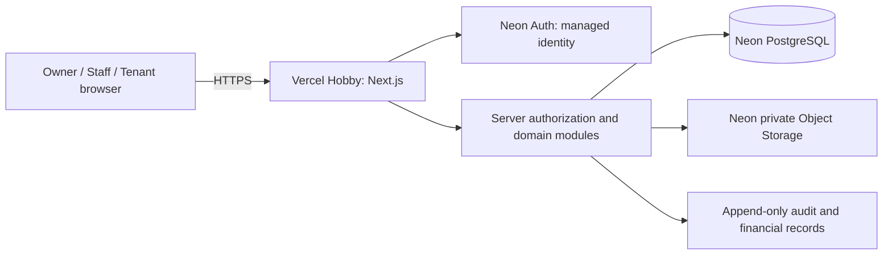

# Functional Specification Document (FSD) — RumaKost

## 1. Document Metadata

- **System / Application Name**: Sistem Manajemen Kost Mandiri (RumaKost)
- **Project Scale**: Medium; satu properti, tujuh kelompok P0
- **Document Status**: Draf untuk review teknis manusia; belum disetujui untuk implementasi
- **PRD Reference**: `docs/specs/PRD.md`
- **Design Reference**: `docs/specs/DESIGN_SPEC.md`, `docs/specs/SITEMAP.md`, `docs/specs/COMPONENT_REQUIREMENTS.md`
- **Data/API model**: `docs/architecture/M05-DATA-API-SPEC-DRAFT.md`
- **Technical stack and rationale**: `docs/architecture/M05-TECHNICAL-SPEC-DRAFT.md`
- **Greenfield assessment**: N/A — repository currently contains product and design documents/prototypes, not an application codebase.

### Batas domain hasil crosswalk M04

Implementasi P0 mengikuti tujuh kelompok fitur Frozen Scope M02. Satu Lease memiliki satu Tenant dan satu kamar; roommate, multi-kamar Tenant, mutasi kamar saat kontrak aktif, properti editable, kapasitas/gender/amenity dinamis, tata tertib dinamis, serta permission Staff granular adalah backlog. InvoiceLine dibatasi ke `RENT` dan `DEPOSIT`; pembayaran di atas saldo terbuka ditolak tanpa credit balance, refund surplus, atau pemindahan tunggakan ke invoice lain. Refund manual hanya muncul dari rekonsiliasi deposit. Expense berdiri sendiri tanpa foreign key ke Ticket. Hanya Tenant pada lease aktif dapat membuat tiket; Owner/Staff mengelola tiket dan mengunggah bukti after-service sesuai izin, tanpa akun Teknisi, rating, garansi, atau kebijakan biaya servis Tenant. Akun Tenant pascakontrak read-only menolak seluruh mutasi dan upload, termasuk klaim pembayaran. Peringatan H-3/H+5, suspensi karena tunggakan, serta ambang kebijakan khusus bukan P0.

## 2. Component Architecture

### 2.1 Architecture and boundaries

Gunakan modular monolith: satu aplikasi Next.js App Router, satu database PostgreSQL pada Neon Free, dan satu bucket privat Neon Object Storage. Modul domain terdiri dari kamar, kontrak, tagihan, pembayaran/deposit, pengeluaran/laporan, serta tiket/media. UI diadaptasi dari prototipe M04 yang sudah dibekukan; demo tidak menambah layanan API, cache, message broker, atau kumpulan worker terpisah.



Trust boundaries: browser input is untrusted; server actions and route handlers authenticate and authorize each operation; database and object storage credentials are server-only; tenants are isolated by explicit ownership predicates. The MVP has one property, so multi-tenant RLS is N/A — single property and `Intake-Branch-Hierarchy: no`; application authorization remains mandatory.

**Existing Repository Assessment**: N/A — no existing application codebase. Design prototypes are HTML/CSS/JavaScript artifacts and are not treated as production source or security controls.

**Caching**: N/A — no application cache at the expected demo scale. Authenticated and private responses use non-public cache directives. **Pemrosesan terjadwal**: pakai satu pemanggilan Vercel Cron per hari untuk invoice yang jatuh tempo dan pembersihan retensi; operasi harus idempotent karena jadwal Hobby dibatasi harian dan waktunya dapat bergeser dalam satu jam. Handler menolak request tanpa Bearer `CRON_SECRET`. Jika Cron tidak tersedia pada project, hentikan otomatisasi dan lakukan tindakan Owner manual tanpa menambah biaya.

### 2.2 Relational Database Schema

#### Entity Relationship Diagram

```mermaid
erDiagram
  APP_USER ||--o{ LEASE : creates_or_holds
  ROOM ||--o{ LEASE : assigned_to
  LEASE ||--o{ INVOICE : billed_by
  INVOICE ||--|{ INVOICE_LINE : itemizes
  INVOICE ||--o{ PAYMENT : receives
  PAYMENT ||--o{ PAYMENT_ALLOCATION : allocates
  INVOICE_LINE ||--o{ PAYMENT_ALLOCATION : applied_to
  LEASE ||--o{ DEPOSIT_LEDGER_ENTRY : tracks_escrow
  PAYMENT ||--o| PAYMENT_REVERSAL : reversed_by
  APP_USER ||--o{ EXPENSE : records
  ROOM ||--o{ TICKET : concerns
  APP_USER ||--o{ TICKET : creates_or_assigned
  TICKET ||--o{ TICKET_COMMENT : contains
  TICKET ||--o{ TICKET_ATTACHMENT : has
  APP_USER ||--o{ AUDIT_EVENT : performs

  APP_USER { uuid id PK; text auth_subject UK; text email_normalized UK; app_role role }
  ROOM { uuid id PK; text code UK; numeric monthly_rent }
  LEASE { uuid id PK; uuid room_id FK; uuid tenant_user_id FK; date starts_on; date ends_on; billing_mode billing_mode }
  INVOICE { uuid id PK; uuid lease_id FK; date period_start; date period_end; date due_on }
  INVOICE_LINE { uuid id PK; uuid invoice_id FK; text kind; numeric amount }
  PAYMENT { uuid id PK; uuid invoice_id FK; numeric amount; payment_status status }
  PAYMENT_ALLOCATION { uuid id PK; uuid payment_id FK; uuid invoice_line_id FK; numeric amount }
  DEPOSIT_LEDGER_ENTRY { uuid id PK; uuid lease_id FK; text kind; numeric amount }
  PAYMENT_REVERSAL { uuid id PK; uuid payment_id FK; numeric amount; text reason }
  EXPENSE { uuid id PK; numeric amount; date occurred_on }
  TICKET { uuid id PK; uuid room_id FK; uuid created_by FK; text status }
  TICKET_COMMENT { uuid id PK; uuid ticket_id FK; uuid author_id FK; text visibility }
  TICKET_ATTACHMENT { uuid id PK; uuid ticket_id FK; text object_key UK; bigint size_bytes }
  AUDIT_EVENT { uuid id PK; uuid actor_id FK; text action; timestamptz occurred_at }
```

- **Object storage decision**: Neon Object Storage (selected), private bucket; signed URLs dibuat server setelah pemeriksaan role/kepemilikan; validasi MIME/ukuran/durasi di server; retensi 365 hari setelah tiket ditutup; tanpa CDN publik.

Daftar entitas logis, constraint, ERD, matriks operasi, dan invarian finansial tersedia di `docs/architecture/M05-DATA-API-SPEC-DRAFT.md`. DDL PostgreSQL berikut mencatat batas integritas utama; nama final dan foreign key autentikasi provider harus dicocokkan dengan schema Neon Auth saat perencanaan implementasi.

```sql
CREATE TYPE app_role AS ENUM ('OWNER', 'STAFF', 'TENANT');
CREATE TYPE payment_status AS ENUM ('PENDING', 'VERIFIED', 'REJECTED');
CREATE TYPE billing_mode AS ENUM ('PRORATA_TO_MONTH_END', 'FULL_MONTH_ANNIVERSARY');

CREATE TABLE app_user (
  id uuid PRIMARY KEY DEFAULT gen_random_uuid(),
  auth_subject text NOT NULL UNIQUE,
  email_normalized text NOT NULL UNIQUE,
  display_name text NOT NULL,
  role app_role NOT NULL,
  is_active boolean NOT NULL DEFAULT true,
  created_at timestamptz NOT NULL DEFAULT now()
);

CREATE TABLE room (
  id uuid PRIMARY KEY DEFAULT gen_random_uuid(),
  code text NOT NULL UNIQUE,
  floor text,
  monthly_rent numeric(12,2) NOT NULL CHECK (monthly_rent >= 0),
  deposit_default_amount numeric(12,2) NOT NULL DEFAULT 0 CHECK (deposit_default_amount >= 0),
  physical_status text NOT NULL,
  created_at timestamptz NOT NULL DEFAULT now()
);

CREATE TABLE lease (
  id uuid PRIMARY KEY DEFAULT gen_random_uuid(),
  room_id uuid NOT NULL REFERENCES room(id),
  tenant_user_id uuid NOT NULL REFERENCES app_user(id),
  starts_on date NOT NULL,
  ends_on date,
  rent_amount numeric(12,2) NOT NULL CHECK (rent_amount > 0),
  deposit_agreed_amount numeric(12,2) NOT NULL DEFAULT 0 CHECK (deposit_agreed_amount >= 0),
  billing_mode billing_mode NOT NULL,
  status text NOT NULL,
  created_by uuid NOT NULL REFERENCES app_user(id),
  CHECK (ends_on IS NULL OR ends_on > starts_on)
);

CREATE TABLE invoice (
  id uuid PRIMARY KEY DEFAULT gen_random_uuid(),
  lease_id uuid NOT NULL REFERENCES lease(id),
  period_start date NOT NULL,
  period_end date NOT NULL,
  due_on date NOT NULL,
  kind text NOT NULL,
  issued_at timestamptz NOT NULL DEFAULT now(),
  UNIQUE (lease_id, period_start, period_end, kind)
);

CREATE TABLE invoice_line (
  id uuid PRIMARY KEY DEFAULT gen_random_uuid(),
  invoice_id uuid NOT NULL REFERENCES invoice(id),
  kind text NOT NULL CHECK (kind IN ('RENT', 'DEPOSIT')),
  amount numeric(12,2) NOT NULL CHECK (amount > 0),
  description text NOT NULL
);

CREATE TABLE payment (
  id uuid PRIMARY KEY DEFAULT gen_random_uuid(),
  invoice_id uuid NOT NULL REFERENCES invoice(id),
  amount numeric(12,2) NOT NULL CHECK (amount > 0),
  status payment_status NOT NULL DEFAULT 'PENDING',
  recorded_by uuid NOT NULL REFERENCES app_user(id),
  verified_by uuid REFERENCES app_user(id),
  verified_at timestamptz,
  created_at timestamptz NOT NULL DEFAULT now(),
  CHECK ((status = 'VERIFIED') = (verified_by IS NOT NULL AND verified_at IS NOT NULL))
);

CREATE TABLE payment_allocation (
  id uuid PRIMARY KEY DEFAULT gen_random_uuid(),
  payment_id uuid NOT NULL REFERENCES payment(id),
  invoice_line_id uuid NOT NULL REFERENCES invoice_line(id),
  amount numeric(12,2) NOT NULL CHECK (amount > 0),
  UNIQUE (payment_id, invoice_line_id)
);

CREATE TABLE deposit_ledger_entry (
  id uuid PRIMARY KEY DEFAULT gen_random_uuid(),
  lease_id uuid NOT NULL REFERENCES lease(id),
  payment_allocation_id uuid UNIQUE REFERENCES payment_allocation(id),
  kind text NOT NULL CHECK (kind IN ('COLLECTED', 'APPLIED_TO_RENT', 'WITHHELD_AT_CHECKOUT', 'REFUNDED')),
  amount numeric(12,2) NOT NULL CHECK (amount > 0),
  reason text,
  created_by uuid NOT NULL REFERENCES app_user(id),
  created_at timestamptz NOT NULL DEFAULT now()
);

CREATE TABLE payment_reversal (
  id uuid PRIMARY KEY DEFAULT gen_random_uuid(),
  payment_id uuid NOT NULL UNIQUE REFERENCES payment(id),
  amount numeric(12,2) NOT NULL CHECK (amount > 0),
  reason text NOT NULL,
  created_by uuid NOT NULL REFERENCES app_user(id),
  created_at timestamptz NOT NULL DEFAULT now()
);

CREATE TABLE expense (
  id uuid PRIMARY KEY DEFAULT gen_random_uuid(),
  category text NOT NULL,
  amount numeric(12,2) NOT NULL CHECK (amount > 0),
  occurred_on date NOT NULL,
  description text NOT NULL,
  recorded_by uuid NOT NULL REFERENCES app_user(id),
  created_at timestamptz NOT NULL DEFAULT now()
);

CREATE TABLE ticket (
  id uuid PRIMARY KEY DEFAULT gen_random_uuid(),
  room_id uuid NOT NULL REFERENCES room(id),
  created_by uuid NOT NULL REFERENCES app_user(id),
  assigned_to uuid REFERENCES app_user(id),
  title text NOT NULL,
  description text NOT NULL,
  priority text NOT NULL,
  status text NOT NULL,
  closed_at timestamptz,
  created_at timestamptz NOT NULL DEFAULT now()
);

CREATE TABLE ticket_comment (
  id uuid PRIMARY KEY DEFAULT gen_random_uuid(),
  ticket_id uuid NOT NULL REFERENCES ticket(id),
  author_id uuid NOT NULL REFERENCES app_user(id),
  body text NOT NULL,
  visibility text NOT NULL CHECK (visibility IN ('TENANT_VISIBLE', 'INTERNAL')),
  created_at timestamptz NOT NULL DEFAULT now()
);

CREATE TABLE ticket_attachment (
  id uuid PRIMARY KEY DEFAULT gen_random_uuid(),
  ticket_id uuid NOT NULL REFERENCES ticket(id),
  uploaded_by uuid NOT NULL REFERENCES app_user(id),
  object_key text NOT NULL UNIQUE,
  mime_type text NOT NULL,
  size_bytes bigint NOT NULL CHECK (size_bytes > 0),
  duration_seconds integer,
  delete_after timestamptz,
  deleted_at timestamptz
);

CREATE TABLE idempotency_keys (
  key uuid PRIMARY KEY,
  operation text NOT NULL,
  response_code integer,
  response_payload jsonb,
  completed_at timestamptz,
  created_at timestamptz NOT NULL DEFAULT now()
);

CREATE TABLE audit_event (
  id uuid PRIMARY KEY DEFAULT gen_random_uuid(),
  actor_id uuid REFERENCES app_user(id),
  action text NOT NULL,
  entity_type text NOT NULL,
  entity_id uuid NOT NULL,
  reason text,
  safe_metadata jsonb NOT NULL DEFAULT '{}'::jsonb,
  occurred_at timestamptz NOT NULL DEFAULT now()
);

CREATE INDEX idx_lease_room_dates ON lease (room_id, starts_on, ends_on);
CREATE INDEX idx_invoice_lease_due ON invoice (lease_id, due_on);
CREATE INDEX idx_payment_invoice_status ON payment (invoice_id, status);
CREATE INDEX idx_ticket_status_created ON ticket (status, created_at DESC);
CREATE INDEX idx_ticket_attachment_delete_after ON ticket_attachment (delete_after) WHERE deleted_at IS NULL;
CREATE INDEX idx_audit_entity_time ON audit_event (entity_type, entity_id, occurred_at DESC);
```

Pencegahan kontrak bertabrakan membutuhkan exclusion constraint PostgreSQL dengan rentang tanggal dan `btree_gist`, atau transaksi serializable dengan penguncian kamar. Pilih dan verifikasi implementasinya pada rancangan migrasi final. Foreign key, validasi nominal, keunikan, tipe uang presisi, dan catatan koreksi immutable wajib diterapkan. Entitas tambahan pada model logis meliputi `tenant_profile`, `lease_end_request`, dan histori status tiket; bentuk constraint final ditetapkan saat rancangan migrasi; keputusan domain tercatat di draf data/API.

### 2.3 Framework Versions & Ecosystem Libraries (Pinned)

- **Framework**: Next.js 16.4.3 (App Router)
- **React / React DOM**: 19.3.1 / 19.3.1
- **Language / Runtime**: TypeScript 5.9.3; Node.js 24.x (tersedia di Vercel; [`engines.node`](https://vercel.com/docs/functions/runtimes/node-js/node-js-versions))
- **Database Engine**: PostgreSQL (Neon Free)
- **ORM**: Prisma (exact package version to be pinned at scaffold after registry verification)
- **Authentication**: Neon Auth managed (beta; exact SDK version to be pinned at scaffold)
- **Object storage**: Neon Object Storage private buckets (beta)
- **Validation**: Zod 4.6.7 candidate; compatibility must be verified before first use
- **Form state**: React Hook Form 7.91.0 candidate; compatibility must be verified before first use
- **UI styling**: CSS from the approved prototype; Tailwind not selected
- **Tooling pinned at M06 scaffold (2026-10-31)**: `create-next-app` 16.4.3; `eslint` 10.14.0; `eslint-config-next` 16.4.3; TypeScript 5.9.3; `@types/node` 24.19.2; `@types/react` and `@types/react-dom` 19.3.0. Registry and peer checks performed before install; exact resolution recorded in `package-lock.json`.

### 2.4 Architecture Decision Record

The architecture decision is recorded in `docs/governance/ADR.md`: modular monolith on the locked Option A stack, with Cloudflare Workers and the Supabase alternative rejected for this portfolio demo based on compatibility and free storage constraints.

## 3. Application Operations and API Contracts

Mutasi UI internal memakai Server Actions yang memeriksa autentikasi. HTTP handler hanya dipakai untuk operasi yang memerlukan URL storage langsung. Operasi domain, otorisasi, input, efek, dan kode error tercatat di `M05-DATA-API-SPEC-DRAFT.md`; daftar dan pencarian selalu dibatasi (default 20, maksimum 100), sementara mutasi saldo atau transisi status bersifat idempotent.

#### POST /api/media/upload-intents

- **Auth**: signed-in Owner/Staff, or Tenant who owns the active ticket; server verifies role and ticket ownership.
- **Request**: `ticketId`, declared `fileName`, `contentType`, `sizeBytes`, optional `durationSeconds`, idempotency key.
- **Success**: `201`; returns opaque attachment ID, short-lived signed upload URL, and expiry. URL is created only after quota and ticket authorization checks.
- **Error**: `401`, `403`/non-enumerating `404`, `409` idempotency/quota conflict, `413` file too large, `415` unsupported media, `503` provider unavailable.

#### POST /api/media/attachments/{attachmentId}/download-url

- **Auth**: Owner/Staff with ticket access or Tenant owning a tenant-visible attachment; visibility and ownership rechecked server-side.
- **Request**: empty JSON body; attachment ID is in the route.
- **Success**: `200`; short-lived signed download URL, no object key disclosure.
- **Error**: `401`, `403`/non-enumerating `404`, `410` deleted media, `503` provider unavailable.

Mutasi aplikasi lainnya memakai Server Actions dan mengikuti kontrak operasi Bagian 5 pada spesifikasi data/API. Hasilnya berupa respons domain bertipe; detail internal database/provider tidak pernah dikirim. Tidak ada API publik atau tanpa autentikasi.

## 4. Role Capability and Limitation Matrix

| Role | Boleh Dilakukan (Allowed Capabilities) | DILARANG / UI MASKED | Dedicated view and server enforcement |
|---|---|---|---|
| Owner | Full access to one property's rooms, tenants, leases, invoices, payments, reversals, deposit reconciliation, expenses, reports, ticket assignment, internal notes, role management, and audit events. | Cannot introduce payment gateways, multiple properties, or real sensitive demo data without approved scope change. | Owner management workspace. Server checks Owner role for payment verify/reject/reversal, financial reports, account administration, audit data, and deposit reconciliation. |
| Staff | View assigned/operational rooms and related tenant/lease details; create/check-in contracts when authorized; create permitted expenses; record pending payment claims; manage tickets and internal comments. | Cannot verify/reject/reverse any payment; cannot approve own work; cannot see Owner financial reports/audit events; cannot change active lease terms or approve deposit reconciliation; cannot access unrelated tenant data. | Dedicated operational workspace. Every Server Action and Route Handler repeats role and resource checks; unauthorized operations return 403 or non-enumerating 404. |
| Tenant | View own profile, current/historical lease, own invoices/payment history, own tickets and visible comments/media; submit payment claim; request checkout; create/comment on own ticket. | Cannot view other Tenants, room management, internal comments, Owner/Staff data, financial reports, audit events, or administrative actions. Cannot choose internal comment visibility or sign arbitrary media URLs. | Dedicated tenant portal. Every query is scoped to authenticated user and owned lease/ticket; UI masking is supplemental only. |

## 5. Security Blueprint

### 5.1 Data classification and threat-to-control mapping

| ID / threat | Data and risk | Control and enforcement point | Planned verification in M07 |
|---|---|---|---|
SEC-01 Spoofing/session theft | Accounts and authenticated sessions | Neon Auth managed authentication; secure, HTTP-only, same-site cookies; server-side session validation for every protected action; sign-out invalidates session. No auth token in localStorage. | Test expired/revoked sessions, CSRF posture, cookie attributes, and unauthenticated actions. |
SEC-02 Credential attacks | Passwords and account access | Password hashing is delegated to Neon Auth managed identity; application does not receive/store raw passwords. Provider password reset only; no custom WhatsApp OTP. Apply auth-provider and edge rate limits, target 5 attempts/minute per IP/account with progressive delay; avoid account enumeration. | Repeated login/reset tests, response equivalence, provider control verification, rate-limit boundary test. |
SEC-03 Tampering/replay | Payment, invoice, lease, deposit and expense state | Server-authoritative validation; PostgreSQL transactions, unique constraints, row locking for verification/reversal/settlement, idempotency keys, Decimal amounts, append-only audit events. Client-supplied role/status/balance is ignored. | Replay/concurrent mutation integration tests; verify no duplicate balance effect and valid audit trail. |
SEC-04 Information disclosure | Contact, lease, finance and ticket data | Data minimization; synthetic records only; role and ownership authorization in data access layer and every Server Action/Route Handler. Staff financial responses are omitted server-side. UU PDP baseline privacy practices apply; no formal assurance claim. | Cross-role and cross-tenant denial matrix; inspect response payloads, logs, exports, and error responses. |
SEC-05 Ticket media exposure | Private photos/videos | Neon private bucket, random opaque keys, server MIME/signature/size/duration checks, authorization before short-lived signed URL, private cache controls, orphan cleanup and deletion after 365 days. | Attempt public access, expired URL, cross-tenant fetch, spoofed MIME, oversized media, and retention cleanup. |
SEC-06 Injection and unsafe content | Form fields, comments, search and file names | Schema validation on server, parameterized Prisma queries, output escaping, safe text-only rendering for user prose, normalized filenames not used as object keys. | XSS payload tests, malformed input tests, SQL injection probes and filename traversal attempts. |
SEC-07 Denial of service/cost exhaustion | Auth, media uploads, database and free-tier quotas | Rate limits on authentication and upload intents; bounded pagination; server-side file quota of 40 MB/ticket and internal storage cap 4 GB/project; reject upload when cap is reached; no automatic paid upgrade. | Burst and quota-exhaustion tests, verify fail-closed behavior and no upload after cap. |
SEC-08 Repudiation/data loss | Financial mutations and demo continuity | Append-only audit event for sensitive actions; managed provider encryption at rest and HTTPS in transit; daily logical export/snapshot if free plan supports it. Proposed portfolio RPO 24 hours, RTO 8 hours; test restore procedure before technical sign-off. No application AES-256-GCM layer unless a concrete field-level threat requires it. | Confirm provider encryption evidence, audit completeness, backup availability and restore drill. |

**Encryption at rest**: rely on Neon/Vercel managed encryption for provider storage; application-level AES-256-GCM is not selected because the MVP excludes identity documents, bank details, and payment receipts, and managed data storage is already the chosen boundary. Secrets use provider environment-variable storage and are never committed. **OWASP**: address access control, injection, session management, CSRF, XSS, SSRF, and unrestricted resource consumption at the listed enforcement points. Privacy: comply with the project's UU PDP baseline through data minimization, purpose limitation, access restriction, and deletion policy; legal review is outside this technical specification.

### 5.2 Typed environment contract and secret handling

Nama variabel deployment berikut dicatat tanpa nilainya; secret tidak boleh ditulis di dokumen atau chat. Vercel Hobby hanya mengizinkan satu eksekusi Cron per hari dan waktu panggilnya dapat bergeser; route harus idempotent dan mengotorisasi dengan `CRON_SECRET` ([Vercel Cron pricing and limits](https://vercel.com/docs/cron-jobs/usage-and-pricing), [securing Cron Jobs](https://vercel.com/docs/cron-jobs/manage-cron-jobs)):

| Variable | Scope | Validation | Handling |
|---|---|---|---|
| `DATABASE_URL` | Server | PostgreSQL URL, non-empty | Pooled Neon runtime URL; server-only. |
| `DIRECT_URL` | Migration only | PostgreSQL URL, non-empty | Direct Neon migration URL; never exposed to browser. |
| `NEON_AUTH_BASE_URL` | Server | Valid HTTPS URL | Provider endpoint; public origin only if SDK requires it. |
| `NEON_AUTH_SECRET` | Server | Non-empty high-entropy secret | Server-only; rotate through provider console. |
| `NEON_STORAGE_ENDPOINT` | Server | Valid HTTPS URL | Server-only storage API endpoint. |
| `NEON_STORAGE_ACCESS_KEY` | Server | Non-empty secret | Server-only; least-privilege storage access. |
| `NEON_STORAGE_SECRET_KEY` | Server | Non-empty secret | Server-only; rotate on suspected exposure. |
| `APP_ORIGIN` | Server | Valid HTTPS URL outside local development | Allowed origin for redirects/CSRF checks. |
| `CRON_SECRET` | Server | Random secret with at least 16 characters | Bearer authentication for daily scheduled route; server-only. |

Buat `.env.example` dengan nilai kosong yang terdokumentasi dan modul environment server yang divalidasi Zod saat scaffold. Simpan nilai sebenarnya hanya di `.env.local` atau secret provider; jangan meminta secret lewat chat dan jangan membaca `.env.local` untuk memverifikasinya. Pastikan `.env*` diabaikan Git kecuali `.env.example`. Aplikasi gagal startup bila variabel wajib hilang/tidak valid. Rotasi secret segera jika ter-commit atau terekspos.

### 5.3 Privacy, retention, backups, and incident boundary

- Demo data must be wholly synthetic. No interview participant data, actual tenant contact details, NIK, identity files, bank account data, or transfer receipts.
- Retain ticket media until 365 days after closure; purge via an idempotent cleanup operation. Financial/audit events are not hard-deleted; correct them through reversal or append-only changes.
- Neon Free menyediakan instant restore/PITR sampai 6 jam dengan batas histori perubahan 1 GB ([plan limits](https://neon.com/docs/introduction/plans)). Batas ini tidak menggantikan backup independen. Karena data demo sintetis, pemulihan awal memakai migrasi dan seed yang dapat diulang; Owner menjalankan PITR bila perlu dan mendokumentasikan hasil restore drill pada M07. Target operasional demo yang diusulkan: RPO maksimal 6 jam selama histori berada dalam kuota dan RTO 8 jam; keduanya bukan SLA.
- Do not log credentials, session tokens, signed URLs, raw uploaded content, or internal comments in application logs. Security incident response: revoke affected provider credentials, invalidate sessions, disable uploads if needed, preserve audit evidence, and restore from a verified backup.

### 5.4 Security requirement traceability

| Requirement | Control | Component | Verification |
|---|---|---|---|
| REQ-01.2/01.3 | SEC-01, SEC-04 | Auth adapter, authorization functions | M07 auth/session and role matrix |
| REQ-03.2/04.3/05.1/05.3 | SEC-03, SEC-08 | Domain service, PostgreSQL transaction, audit event | M07 integrity, retry, concurrency tests |
| REQ-06.2 | SEC-04 | Financial report query/service | M07 Staff/Tenant denial and payload audit |
| REQ-07.1/07.3 | SEC-04, SEC-05, SEC-06, SEC-07 | Upload route, private bucket, ticket data layer | M07 upload, access, input, and quota tests |

## 6. Reliability, Capacity, and Cost Controls

- One property and at most five simultaneous demo users, consistent with the frozen scope.
- All list reads are paginated (default 20, maximum 100); ticket/event history uses cursor pagination if it grows.
- No cache or paid external integration. Use bounded connection pooling and distinguish runtime pooled and migration direct database URLs.
- Neon internal storage stop threshold: 4 GB/project, below the stated Free quota; refuse new uploads at/above the internal threshold and alert the Owner through an operational log/state.
- No billing method is to be added to Vercel or Neon. Do not enable paid upgrades or unbounded usage. If a provider changes its no-card/free policy or cannot enforce a safe limit, stop the affected integration and revisit the architecture.
- Restore drill dan pemeriksaan usage alerts menjadi prasyarat sign-off. Ketersediaan selalu aktif tidak dijanjikan; scale-to-zero/tidur diterima untuk demo portfolio.

## 7. Module 04 Handoff Strategy (Strategi Peralihan Prototipe)

**Compatibility Level: Level 2**

Ubah prototipe HTML beku menjadi komponen React Next.js sambil mempertahankan tata letak, copy, token warna/tipografi, perilaku responsif, state, dan interaksi yang disetujui. Ekstrak token CSS/primitif bersama dari aset M04; gunakan peta layar-ke-route/komponen pada `docs/design/SITEMAP.md` dan `docs/specs/COMPONENT_REQUIREMENTS.md`. Ganti simulator role dan data lokal prototipe dengan state server yang terautentikasi; jangan membawa pergantian role lewat query string ke otorisasi produksi. Data contoh prototipe hanya menjadi fixture sintetis. Perilaku yang tidak tercakup scope tetap menjadi backlog; jangan menciptakan UI atau aturan domain saat porting. Persetujuan Design Freeze manusia tercatat di `DESIGN_SPEC.md`.

## 8. Stack Decision dan Input Arsitektur

### Stack Decision (LOCKED — human decision)

Stack Decision LOCKED: Next.js App Router + TypeScript + CSS prototype system; PostgreSQL/Prisma on Neon Free; Neon Auth and private Object Storage beta; Vercel Hobby for non-commercial portfolio demo; zero paid upgrades.
Stack-Locked-by: zeenn on 2026-10-30

- Q1 Team Expertise: Solo developer with AI assistance, documented in `PROJECT_STATE.md`; no additional engineering team.
- Q2 Database Experience: Experience level was not recorded; choose managed PostgreSQL with Prisma to keep operational work bounded. Treat ORM/database conventions as a learning item in M06 planning, not a claim of prior expertise.
- Q3 Deployment Topology: One Next.js deployment on Vercel Hobby plus one Neon PostgreSQL database and one private Neon Object Storage bucket; confirmed by owner stack choice.
- Q4 Expected Scale (Year 1): Portfolio demo, one property, up to five concurrent users, no commercial SLA; from `SCOPE_STATEMENT.md`.
- Q5 Data Model Characteristics: Relational room/tenant/lease/invoice/payment/expense/ticket data, precise monetary values, immutable correction records, and private ticket media; from P0 scope and M04.
- Q6 DevOps Complexity Tolerance: Low-cost, no-card setup and minimal operational overhead; owner explicitly selected no-card hosting and accepted beta for demo.
- Q7 Critical Feature Priority: Seven P0 groups F-01–F-07, especially financial integrity, role/ownership isolation, and private maintenance media; from `SCOPE_STATEMENT.md`.
- Q8 Compliance Requirements: Baseline privacy under UU PDP; no formal assurance, no real sensitive identity/banking data, synthetic demo data only; from intake and scope.

### Pilihan arsitektur dan alternatif

- **Chosen**: modular monolith, one database, one private object store, server-side authorization.
- **Rejected for this demo**: Cloudflare Workers as primary host because the available Next.js compatibility path introduces framework/runtime translation; Supabase Free because its stated storage allowance is below the internal media forecast. Re-evaluate only if the chosen providers require a card, paid usage, or cannot meet private-media controls.
- **ADR**: `docs/governance/ADR.md`.

## 9. Pemetaan Skenario M04 ke Implementasi

`docs/design/SCENARIO_EVALUATION.md` memuat 613 skenario WF-01 sampai WF-12 serta enam acceptance walkthrough E2E. Matriks mencatat klasifikasi scope dan lapisan verifikasi yang disarankan; status seluruh skenario adalah belum dieksekusi.

Pemetaan saat ini: 498 skenario kandidat P0 ditautkan ke REQ; 115 skenario backlog/out-of-scope mencakup perluasan di luar M02. Enam E2E adalah acceptance walkthrough yang belum dieksekusi, bukan bukti PASS. Seluruh klasifikasi menunggu technical sign-off manusia.

| Walkthrough E2E | P0 yang dipertahankan | Penyesuaian agar sesuai scope M02 |
|---|---|---|
| 01 Onboarding kamar, kontrak, invoice awal | F-02, F-03, F-04, F-05: kontrak, mode billing, invoice, verifikasi klaim pembayaran, dan escrow | Tidak menggunakan bukti transfer atau kuitansi; pakai klaim pembayaran manual dengan fixture sintetis. |
| 02 Tagihan bulanan dan cicilan | F-04 dan F-05: invoice berulang, pembayaran parsial, saldo, dan verifikasi Owner | Sub-meter listrik dan penagihan utilitas tetap backlog. |
| 03 Tiket kerusakan | F-07: tiket, media privat, status, komentar penghuni dan catatan internal | Akun/WhatsApp teknisi eksternal dan biaya servis tertaut ke tiket dikeluarkan; penanggung jawab internal hanya Owner/Staff aktif jika diputuskan. |
| 04 Pengeluaran dan laporan | F-06: catat pengeluaran, ringkasan arus kas/okupansi Owner-only | Struk, ekspor/print, dan akuntansi formal tidak masuk MVP. |
| 05 Check-out dan turnover | F-02, F-03, F-05: check-out, inspeksi Owner, rekonsiliasi escrow, status kamar | Detail rekening tujuan dan transfer refund otomatis tidak disimpan/dilakukan. |
| 06 Pembayaran dan koreksi | F-05: pembayaran, verifikasi, saldo parsial, reversal beralasan | Skenario multi-kamar disederhanakan menjadi satu lease; kuitansi/bukti transfer tidak digunakan. |

Akun/password contoh di runbook tidak boleh disalin sebagai kredensial aplikasi. M07 harus membuat kredensial dan data sintetis baru; jangan memakai data kontak/nomor rekening yang terlihat seperti data riil.
## 10. Keputusan Domain Terkonfirmasi dan Technical Sign-Off

Keputusan domain disetujui Owner (`zeenn`) pada 2026-10-30: pembayaran parsial dialokasikan ke sewa dahulu lalu deposit; seed demo menyertakan akun Staff sintetis; Tenant pascakontrak hanya membaca histori miliknya tanpa mutasi/unggah; foto menerima JPEG/PNG/WebP dan video MP4/MOV dengan validasi konten di server. Operasi gratis menerima scale-to-zero/tidur, Vercel Cron sekali sehari, serta Neon Free PITR dengan batas 6 jam/1 GB histori. Rujukan dan batas provider tercatat pada bagian operasi dan sumber FSD.

Review teknis disetujui oleh pemilik pada 2026-10-31 setelah meninjau PRD/FSD, scope, handoff M04, keputusan domain, batas backup, dan kemampuan provider. Persetujuan ini berlaku untuk spesifikasi dan stack M05, bukan implementasi atau pengujian runtime.

- Approved by: zeenn
- Approved on: 2026-10-31
- Validated by Solo Developer: zeenn

### M06 scaffold command (locked)

Run from the repository root after inspecting existing files; preserve `docs/` and frozen design assets. Generate the Next.js App Router project using the locked version and npm, with TypeScript, `src/`, ESLint, and the existing CSS design system; skip dependency installation until pre-install checks complete:

```powershell
npx create-next-app@16.4.3 . --typescript --eslint --app --src-dir --import-alias "@/*" --no-tailwind --use-npm --skip-install --disable-git --yes
```
